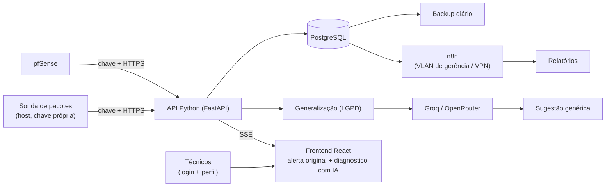

<div align="center">

# SIGMA

**Monitoramento ativo de rede com apoio de IA para a equipe de TI de um hospital oncológico.**

[](https://github.com/Solution-Explores/SigmaTI/actions/workflows/api-config.yml)


-orange)

[Problema](#problema-que-resolve) ·
[Funcionalidades](#funcionalidades) ·
[Arquitetura](#arquitetura) ·
[Início rápido](#início-rápido) ·
[Documentação](docs/README.md)

</div>

Trabalho de conclusão de curso (TCC) para a equipe de TI de uma fundação pública de saúde.

## Problema que resolve

A equipe de TI trabalha sem visibilidade em tempo real da rede e só descobre as falhas quando os usuários reclamam. Isso causa:

- demora para detectar e consertar incidentes (MTTD e MTTR altos);
- técnicos sobrecarregados com tarefas manuais;
- falta de histórico para prevenir falhas.

Em um hospital, a queda da rede afeta prontuários eletrônicos e equipamentos médicos. O SIGMA troca o suporte reativo por monitoramento contínuo, sem custo de licenças.

## Funcionalidades

- **Alertas em tempo real:** o painel exibe qualquer anomalia em até 5 segundos após a detecção (RF01).
- **Captura de tráfego e alertas:** integração com o firewall pfSense e com uma sonda própria de análise de pacotes (RF02).
- **Diagnóstico assistido por IA:** resposta no painel em até 15 segundos (RF03, RNF04).
- **Privacidade (LGPD):** logs e mensagens são generalizados antes de ir à IA. IPs viram sub-redes, equipamentos viram categorias, e nomes e identificadores médicos são removidos. Se o filtro falhar, nada é enviado (RF05).
- **Histórico de incidentes:** PostgreSQL com volume persistente e backup diário (RF04, RNF06).
- **Relatórios automáticos:** o n8n calcula métricas como o MTTR e envia relatórios à coordenação (RF06).
- **Controle de acesso:** login com perfis (Suporte N1, Analista de Redes e Gestor de TI). O n8n só é acessível pela VLAN de gerência ou por VPN (RF07).
- **Segurança de origens:** cada sonda e o pfSense usam chave exclusiva, com HTTPS, revogação e rotação (RNF07).

## Arquitetura



A implantação é híbrida. O Docker Compose orquestra `db` (PostgreSQL) e `n8n`. A API e o frontend rodam no host por enquanto, e a conteinerização deles está planejada. Zabbix e Grafana, uma stack de observabilidade opcional, entram com `--profile monitoring`. A sonda roda no host, porque precisa da interface física de rede. O pfSense fica na rede.

### Tecnologias

| Camada | Tecnologia | Onde roda |
|---|---|---|
| Backend e API | Python e FastAPI | Host |
| Tempo real | SSE | API |
| Banco de dados | PostgreSQL | Contêiner |
| Frontend | React e Vite | Host |
| Automação e relatórios | n8n | Contêiner |
| Análise de pacotes | Analisador customizado, com Wireshark de apoio | Host |
| Firewall | pfSense | Rede |
| IA (LLM) | OpenRouter e Groq (camadas gratuitas) | Nuvem |
| Implantação | Docker e Docker Compose | Servidor on-premise |

Detalhes em [Stack de tecnologia](docs/arquitetura/stack-de-tecnologia.md).

## Início rápido

Pré-requisitos: Docker, Docker Compose, Python 3.12+ e Node.js. O MVP não é uma instalação hospitalar homologada, e a sonda e o pfSense continuam planejados, sem procedimento de instalação.

```bash
git clone --branch develop https://github.com/Solution-Explores/SigmaTI.git
cd SigmaTI
cp .env.example .env          # preencha as credenciais; nunca versione o .env
docker compose up -d          # banco de dados e n8n

python -m venv .venv          # Windows: .venv\Scripts\Activate.ps1 | Linux/macOS: source .venv/bin/activate
python -m pip install -r requirements.txt
python -m uvicorn --app-dir backend main:app --host 127.0.0.1 --port 8000 --reload

cd frontend && npm ci && npm run dev
```

O Compose exige seis variáveis de credenciais e não tem senha padrão. A API exige `OPENROUTER_API_KEY`, `SIGMA_LLM_MODEL`, `SIGMA_CORS_ORIGINS` e `SIGMA_JWT_SECRET`, além de `SIGMA_DATABASE_URL` (PostgreSQL, recomendado) ou `SIGMA_USERS_FILE` (arquivo, só laboratório). Os detalhes estão em:

- [Instalação para desenvolvimento](docs/operacao/instalacao.md), com comandos de Windows e Linux;
- [Configuração e execução](docs/operacao/configuracao-e-execucao.md): credenciais, portas e versões, variáveis da API, origens, erros públicos e chamada à IA;
- [Painel operacional](docs/operacao/painel-operacional.md): execução e testes do frontend;
- [Backup, restauração e atualização](docs/operacao/backup-restauracao.md): `scripts/backup.sh`, `scripts/restore.sh` e `scripts/smoke.sh`.

Para rodar os testes sem chave real nem chamadas externas:

```bash
python -m pip install -r requirements-dev.txt
python -m pytest -q -p no:cacheprovider
```

## Como usar

1. Acesse o painel e faça login com o seu perfil.
2. Acompanhe os alertas e o status da rede em tempo real.
3. Peça à IA uma sugestão de diagnóstico. Ela devolve uma resposta genérica, e o painel mostra o alerta original para você ligá-la ao equipamento exato.
4. O Gestor de TI acessa o n8n (VLAN de gerência ou VPN) para os relatórios e gerencia usuários e chaves.

### Permissões por perfil

| Função | Suporte N1 | Analista de Redes | Gestor de TI |
|---|---|---|---|
| Ver alertas e status da rede | Sim | Sim | Sim |
| Usar o diagnóstico com a IA | Sim | Sim | Sim |
| Ver histórico e detalhes de pacotes | Não | Sim | Sim |
| Ver relatórios gerenciais | Não | Não | Sim |
| Gerenciar usuários e chaves | Não | Não | Sim |
| Acessar o n8n | Não | Não | Sim |

## Estado do desenvolvimento

- A demonstração controlada segue o [plano de demonstração](docs/planejamento/plano-demonstracao-2026-10-27.md). O [plano de conclusão de 20/10](docs/planejamento/plano-conclusao-2026-10-20.md) registra a ordem de implementação, os cortes de escopo e as dependências externas. Itens planejados não são funcionalidades entregues.
- Com `SIGMA_USERS_FILE`, sessões e usuários alterados ficam em memória. Com PostgreSQL, eles persistem ([identidades e sessões](engenharia/docs/07-persistencia-identidades.md)).
- O [estado operacional no PostgreSQL](engenharia/docs/08-estado-operacional.md) cobre esquema, recuperação de aprovações e execuções, medições, retenção e APIs. Veja também a [coleta de eventos e o SSE](engenharia/docs/09-coleta-eventos.md).
- O experimento E6 avalia cada identificador anotado, e seus resultados valem só para o corpus sintético.
- As issues #5 e #6 continuam abertas.
- A resposta `Incidente Registrado` é um contrato legado e não comprova a gravação de um incidente no PostgreSQL.
- As correções de sessão, painel e anonimização estão nas [evidências da recuperação da sprint](docs/specs/011-recuperacao-sprint/evidencias.md), integradas à `develop` pelo [PR #32](https://github.com/Solution-Explores/SigmaTI/pull/32).
- O ensaio do backup em outra máquina e a ativação do modelo systemd continuam pendentes. A validação local não equivale ao aceite integral da issue #25.

## Segurança e privacidade

- Chaves e senhas ficam em variáveis de ambiente, nunca no código.
- Não há tabela de correspondência (de/para) entre dados originais e generalizados.
- O histórico bruto fica dentro da infraestrutura da instituição, protegido por login, chaves e backup com acesso restrito.
- Evidências e testes usam **só dados fictícios**, nos blocos reservados `192.0.2.0/24`, `198.51.100.0/24`, `203.0.113.0/24` (RFC 5737) e `2001:db8::/32` (RFC 3849).
- A conformidade com o art. 12 da LGPD depende da homologação do DPO ou do jurídico da instituição.

## Validação

| Requisito | Meta |
|---|---|
| RF01 | Alerta no painel em até 5 s |
| RNF04 | Diagnóstico da IA em até 15 s |
| RNF06 | Backup restaurável e sem perda de dados ao recriar contêineres |
| RNF07 | Requisição sem chave, inválida ou revogada é recusada (401 ou 403) |
| RNF08 | Zero vazamentos de dados sensíveis para a IA |

A validação completa está na seção 6 do [estudo de caso](docs/arquitetura/estudo-de-caso.md). O registro de testes e achados corrigidos está em [revisão K01 a K06](docs/specs/revisao-k01-k06/validacao.md).

## Limitações conhecidas

- Sem disco ou local de rede separado, o backup fica no mesmo servidor e não protege contra falha física total.
- As metas de 5 s e 15 s dependem das camadas gratuitas de IA. Com a IA fora do ar, o alerta continua no painel, sem diagnóstico.
- A generalização é feita por regras: reduz o risco, mas não o elimina. Por isso existe a falha segura.
- Arredondar horários e mascarar sub-redes pode reduzir a precisão do diagnóstico. O RNF08 mede essa perda com dados fictícios.
- O servidor on-premise e a VLAN ou VPN de gerência ainda precisam ser confirmados pela instituição.

## Estrutura do projeto

```
backend/       API FastAPI: main.py, routers/, persistence/, migrations/ e tests/
frontend/      painel em React (Vite)
engenharia/    núcleo sigma_eng, testes, experimentos e resultados
scripts/       validação, backup, instalação e utilitários
deploy/        unidade systemd e overlays do Compose
docs/          documentação, specs e evidências (índice em docs/README.md)
docker-compose.yml, docker-images.lock.json, .env.example
```

## Para quem trabalha no TCC

O desenvolvimento segue o [Git Flow](docs/processo/gitflow.md): branches `feature/*` e `fix/*` entram na `develop` por PR, com testes, evidências e revisão, e uma `release/*` prepara a `main`. Comece pelo [fluxo de trabalho do TCC](docs/processo/fluxo-de-trabalho-tcc.md), que explica as etapas, as colunas do quadro e quando uma issue pode ser encerrada. Toda a documentação está indexada em [docs/README.md](docs/README.md).

## Autores

Discentes:

- **Iohand Jheremy**: [LinkedIn](https://www.linkedin.com/in/iohan-jheremy/)
- **Joyce Yasmin**: LinkedIn pendente
- **Vinícius Gomes**: [LinkedIn](https://www.linkedin.com/in/viniciusgomesdev/)

Docente:

- **Euler Azevedo**: [LinkedIn](https://www.linkedin.com/in/eulerazevedo/)
