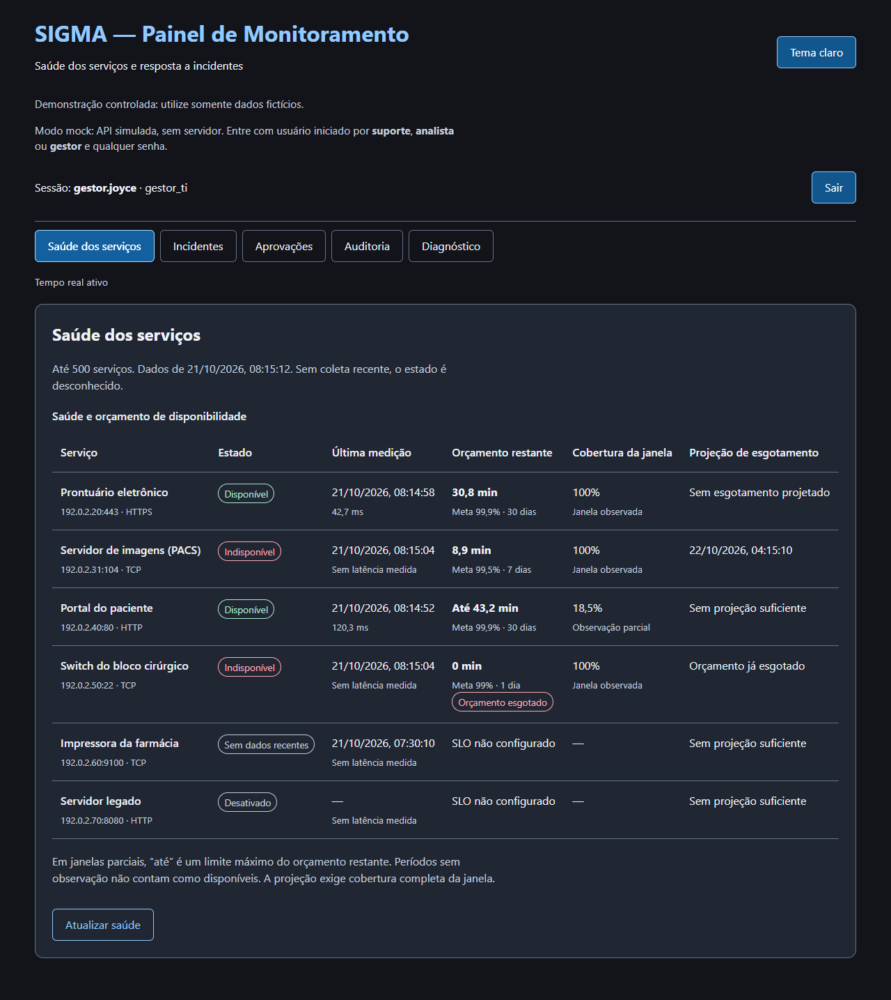

# 2. Estado atual do front

Fotografia do painel em 21/10/2026 (branch `develop`, PRs #39 e #40). As capturas foram
geradas no modo mock e estão em [`capturas/`](capturas/). Para atualizá-las, rode
`npm run dev:mock` e capture as mesmas telas.

## Tecnologia

| Item | Escolha atual | Observação |
|---|---|---|
| Biblioteca | React 19 + Vite 8 | Sem TypeScript |
| Estilo | CSS puro, um único `App.css` (≈60 linhas) e `index.css` | Variáveis CSS como tokens; sem Tailwind e sem biblioteca de componentes |
| Rotas | Nenhuma: a área ativa é um `useState` em `Operations.jsx` | Recarregar a página volta ao login (sessão só em memória, por segurança) |
| Ícones e fontes | Nenhum ícone; fonte do sistema (`system-ui`) | Não há marca nem logo definidos |
| Testes | Vitest + Testing Library; Playwright + axe no CI | O axe reprova contraste insuficiente |

## Telas e onde ficam

| Tela | Perfis | Arquivo / componente | Capturas |
|---|---|---|---|
| Login | todos | `App.jsx` | [escuro](capturas/01-login-escuro.png) · [claro](capturas/02-login-claro.png) |
| Saúde dos serviços | N1, Analista, Gestor | `OperationalPages.jsx` → `HealthPage`, `HealthContent` | [escuro](capturas/10-saude-escuro.png) · [claro](capturas/11-saude-claro.png) · [celular](capturas/30-saude-celular.png) |
| Incidentes | Analista, Gestor | `IncidentsPage`, `IncidentMetrics` | [escuro](capturas/10-incidentes-escuro.png) · [claro](capturas/11-incidentes-claro.png) |
| Aprovações | Analista, Gestor | `ApprovalsPage`, `ApprovalItem` | [escuro](capturas/10-aprovacoes-escuro.png) · [claro](capturas/11-aprovacoes-claro.png) |
| Auditoria | Gestor | `AuditPage`, `AuditContent` | [escuro](capturas/10-auditoria-escuro.png) · [claro](capturas/11-auditoria-claro.png) |
| Diagnóstico (IA) | N1, Analista, Gestor | `Diagnostic.jsx` | [escuro](capturas/10-diagnostico-escuro.png) · [claro](capturas/11-diagnostico-claro.png) |
| Cabeçalho, sessão e navegação | todos | `App.jsx`, `Operations.jsx` | todas |

Estados de tela: [perfil N1](capturas/20-suporte-n1-navegacao.png) ·
[vazio](capturas/21-estado-vazio-saude.png) · [erro](capturas/22-estado-erro-saude.png) ·
[carregando](capturas/23-estado-carregando.png) · [falha de integridade](capturas/24-auditoria-falha-trilha.png).

## O que já está bom e deve ser preservado

- Dois temas (escuro e claro) com os mesmos papéis de cor.
- Estados sempre com texto, foco de teclado amarelo bem visível e link "Ir para o conteúdo".
- Tabelas com legenda, cabeçalhos e rolagem horizontal em telas estreitas.
- Mensagens honestas: "Sem dados recentes", "Até 43,2 min", "Sem início real de falha registrado".
  Essas frases são regras de negócio, não só texto (veja [PRODUCT.md](../PRODUCT.md)).

## Pontos de melhoria observados (ponto de partida para o design system)

Lista levantada nas capturas. Os itens não estão priorizados; a priorização fica com a Joyce.

1. **Sem identidade visual:** não há logo, ícone nem paleta de marca. O título é texto azul.
2. **Avisos no topo ocupam espaço:** "Demonstração controlada" e "Modo mock" empurram o conteúdo para baixo.
   Um banner compacto resolveria.
3. **Papel exibido como código:** a sessão mostra `gestor_ti` em vez de "Gestor de TI".
4. **Incidentes sem hierarquia visual:** severidade (P1/P2/P3) e estado (Aberto/Reconhecido/Resolvido)
   são texto simples, enquanto a Saúde usa badges. Faltam badges de severidade e de estado.
5. **Valores crus da API na tela:** o tipo `latencia` aparece sem acento. Falta um mapa de rótulos,
   como o que já existe para os estados de serviço.
6. **Tempos em segundos:** "2.400 s" é difícil de ler; "40 min" seria melhor. A mudança é só de formatação,
   e a API continua enviando segundos.
7. **Botão desabilitado pouco distinguível:** "Reconhecer" desabilitado usa só opacidade de 0,65, e no tema
   claro fica parecido com o habilitado. Precisa de um estado próprio com contraste conferido.
8. **Hierarquia de títulos no Diagnóstico:** a área tem `h2` "Diagnóstico" e, dentro dela, outros `h2`
   ("Enviar alerta", "Resultado"). O correto seria `h3`, o que afeta leitores de tela.
9. **Tabela da Saúde no celular:** são seis colunas com rolagem horizontal ([captura](capturas/30-saude-celular.png)).
   Em telas pequenas, um layout em cartões pode funcionar melhor.
10. **Badge "Sem dados recentes" quebra em duas linhas** na tabela; falta `white-space: nowrap`.
11. **Tokens só no CSS:** as cores existem em `App.css`, em `DESIGN.md` e em `.impeccable/design.json`.
    Convém eleger uma fonte única (por exemplo `src/styles/tokens.css`) e gerar o resto a partir dela.
12. **Ações destrutivas sem confirmação:** "Resolver incidente" age com um clique.
    Vale propor um padrão de confirmação; a mudança de comportamento é combinada com a integração.

## Documentos de design já existentes

| Arquivo | Conteúdo |
|---|---|
| [`DESIGN.md`](../DESIGN.md) | Tokens e regras extraídos do código (cores, tipografia, raio, espaçamento) |
| [`PRODUCT.md`](../PRODUCT.md) | Contexto do produto, perfis e "verdade dos dados" |
| [`.impeccable/design.json`](../.impeccable/design.json) | Mesmo conteúdo em formato de máquina, com trechos HTML/CSS de cada componente |
| [`specs/017-painel-operacional/brief.md`](../specs/017-painel-operacional/brief.md) | Contrato da extensão operacional (#15) e evidências de acessibilidade |

Todos registram o que **já existe**. Nenhuma composição visual foi aprovada até agora,
e é esse o espaço do design system.
