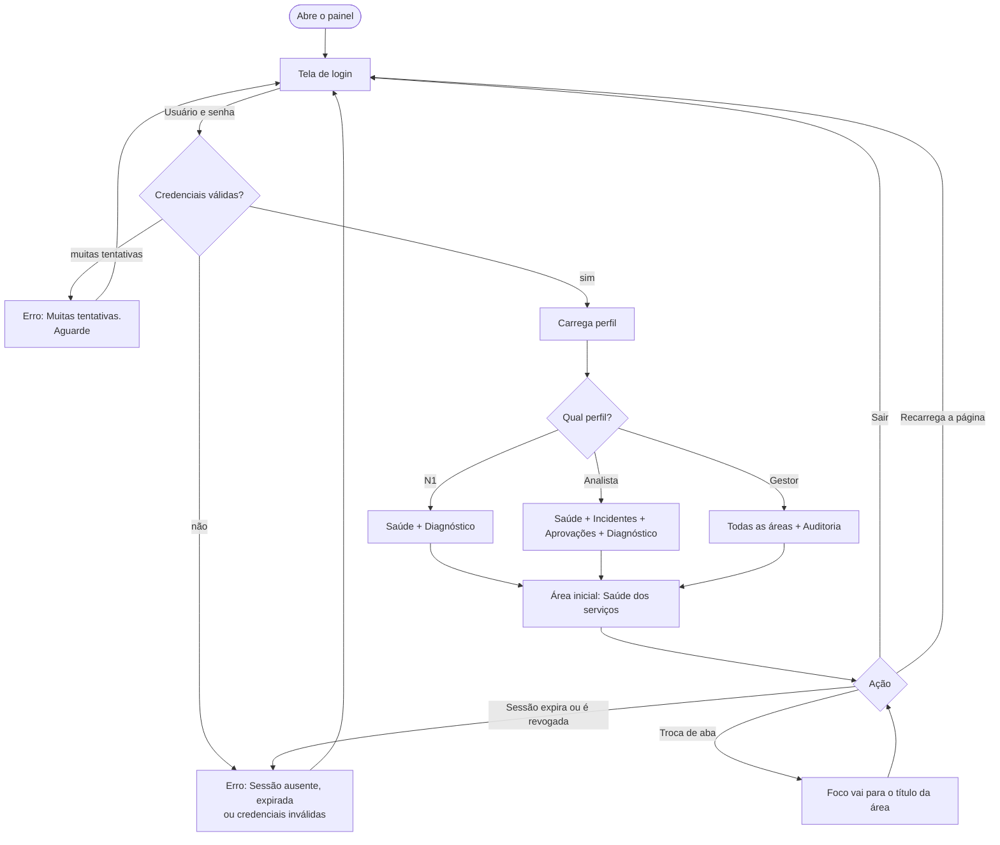
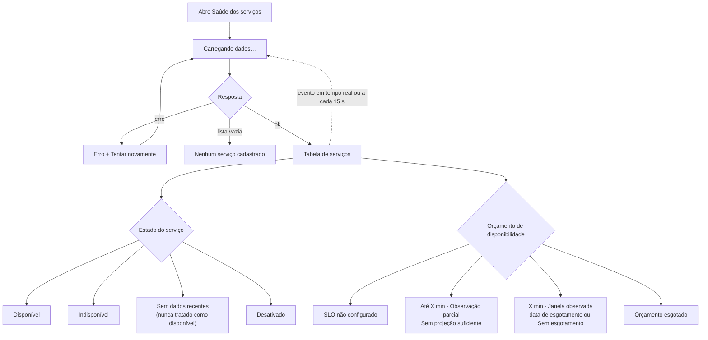
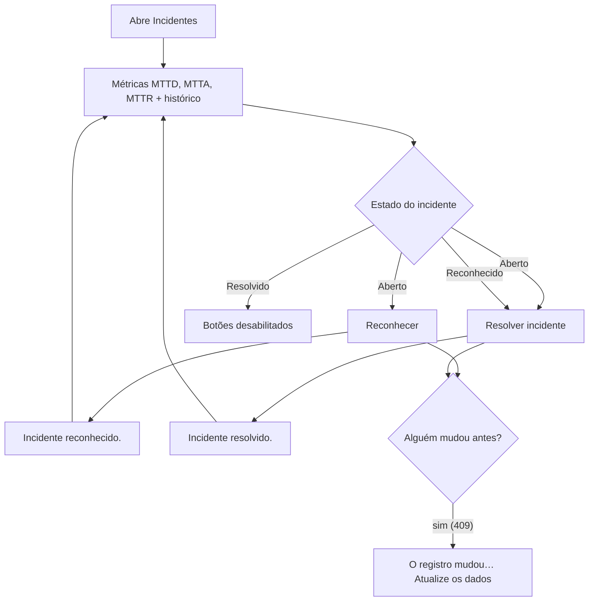
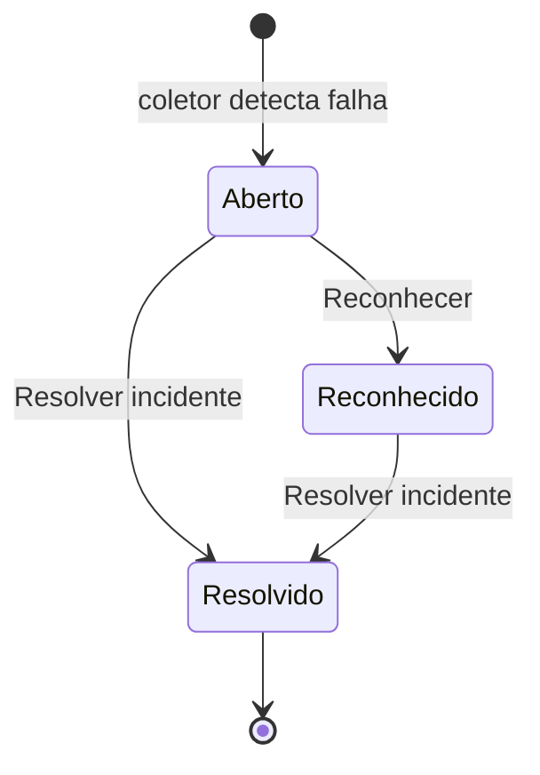
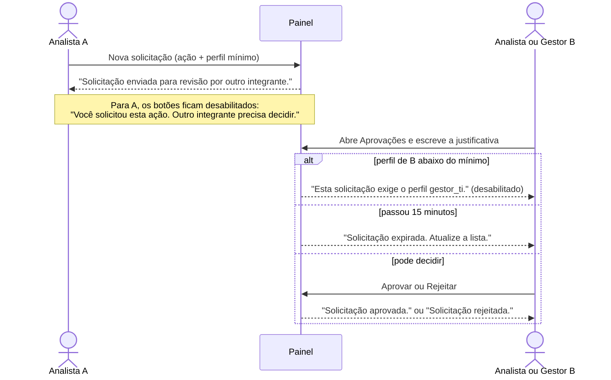
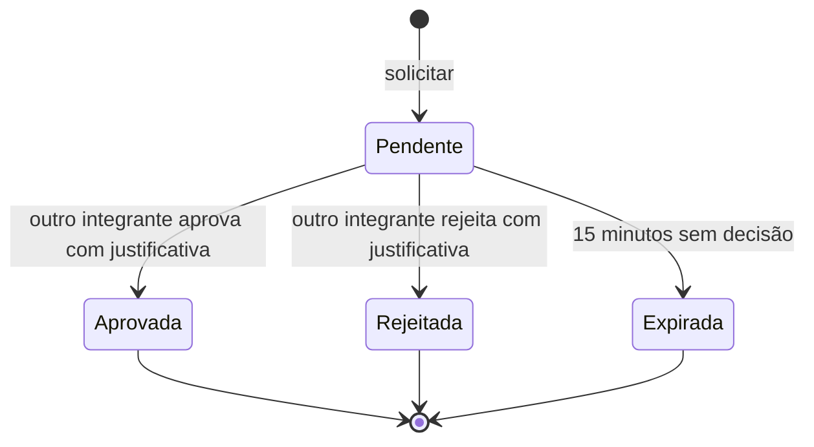
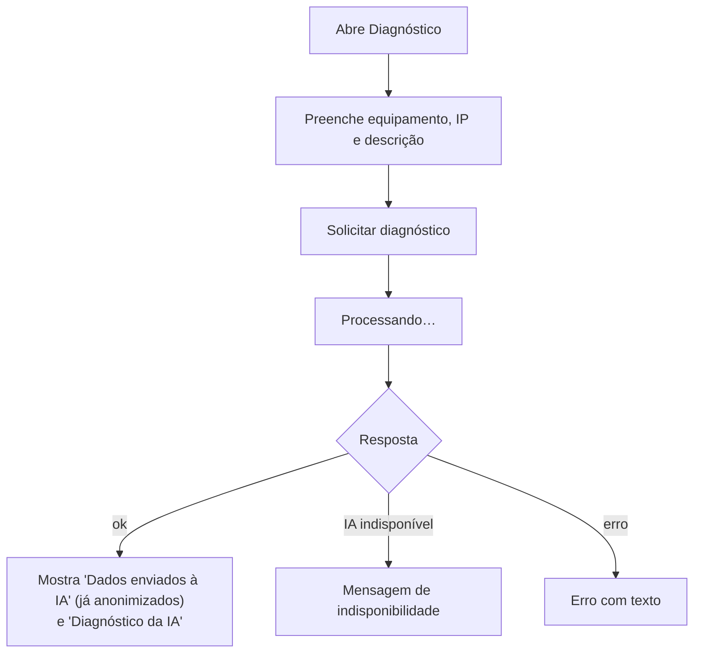
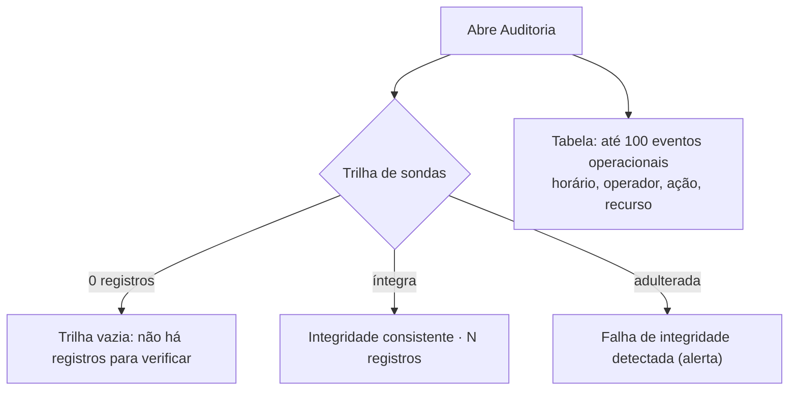
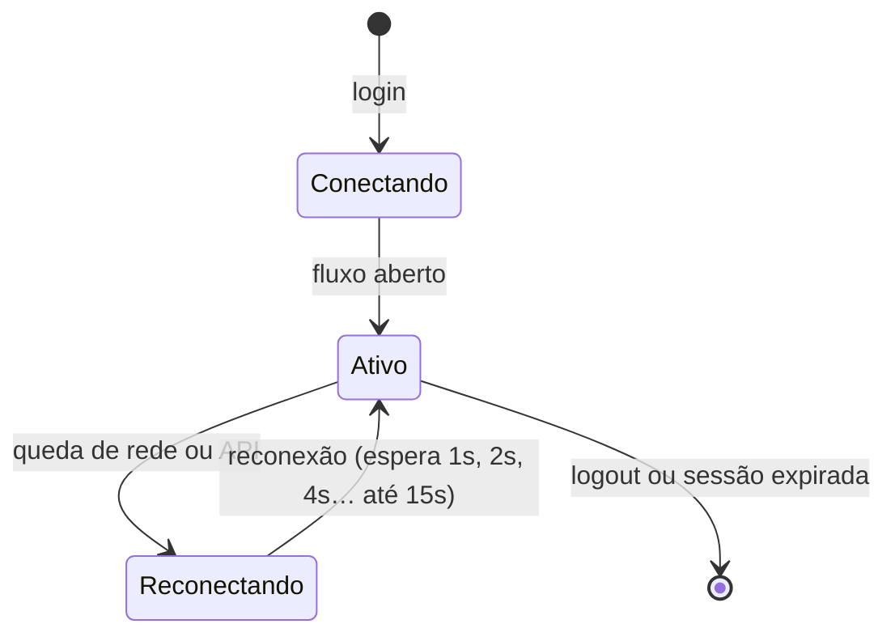

# 4. Fluxos de usuário

Fluxos levantados a partir do código atual (`App.jsx`, `Operations.jsx`, `OperationalPages.jsx`,
`Diagnostic.jsx`) e das regras da API. Cada fluxo indica as telas e mensagens envolvidas,
porque cada caixa é um estado que o design precisa cobrir.

## Perfis

| Perfil | Quem é | Áreas visíveis | Pode agir em |
|---|---|---|---|
| Suporte N1 (`suporte_n1`) | Técnico do primeiro atendimento | Saúde, Diagnóstico | Pedir diagnóstico à IA |
| Analista de Redes (`analista_redes`) | Responsável pela rede | + Incidentes, Aprovações | Reconhecer e resolver incidentes; solicitar e decidir aprovações |
| Gestor de TI (`gestor_ti`) | Coordenação de TI | + Auditoria | Tudo acima, decisões que exigem gestor e consulta à auditoria |

## F1. Entrar, navegar e sair

Observação: recarregar a página sempre volta ao login, porque o token fica só em memória.
Isso é uma decisão de segurança, não um defeito.

## F2. Acompanhar a saúde dos serviços (todos os perfis)

## F3. Tratar um incidente (Analista e Gestor)

Ciclo de vida do incidente:

## F4. Aprovação "quatro olhos" (Analista e Gestor)

Uma ação sensível, como reiniciar uma porta de switch, precisa da decisão de **outra pessoa**
com perfil suficiente. A página só registra a decisão e não executa nenhum comando.

## F5. Diagnóstico com IA (todos os perfis)

A seção "Dados enviados à IA" existe para mostrar ao usuário que IPs e nomes foram generalizados
antes de sair do hospital (LGPD). Ela é uma peça de confiança e não deve ser escondida.

## F6. Auditoria (Gestor)

## F7. Tempo real

Textos exibidos: "Conectando ao tempo real…", "Tempo real ativo" e "Reconectando ao tempo real;
dados atualizados também a cada 15 segundos." Mesmo sem tempo real, as telas se atualizam a cada 15 s.
