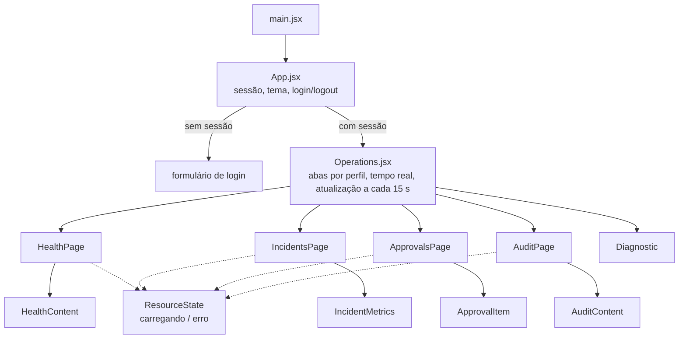
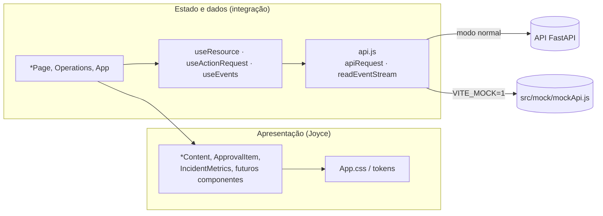
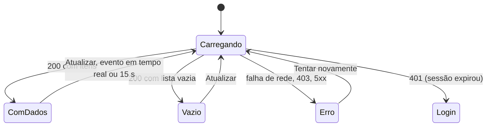
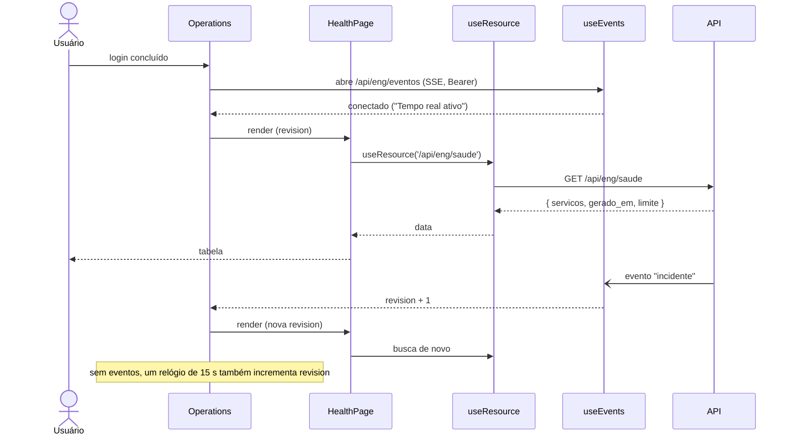
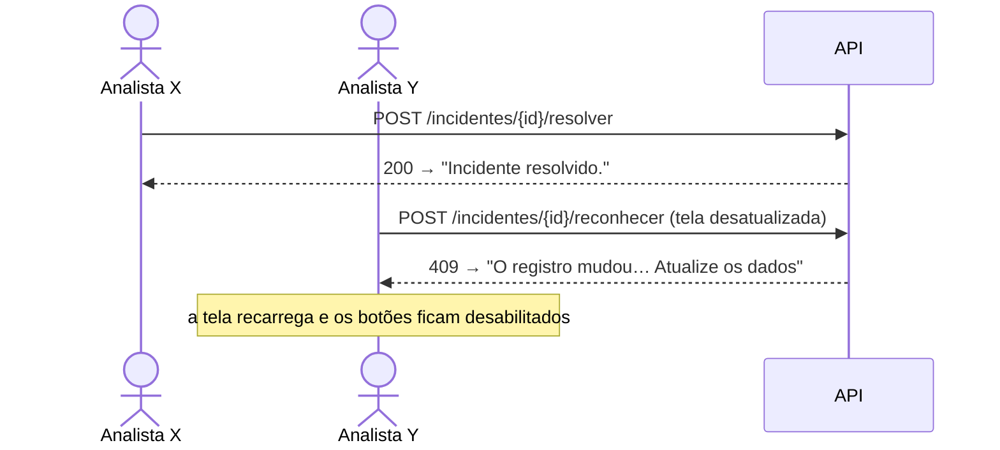
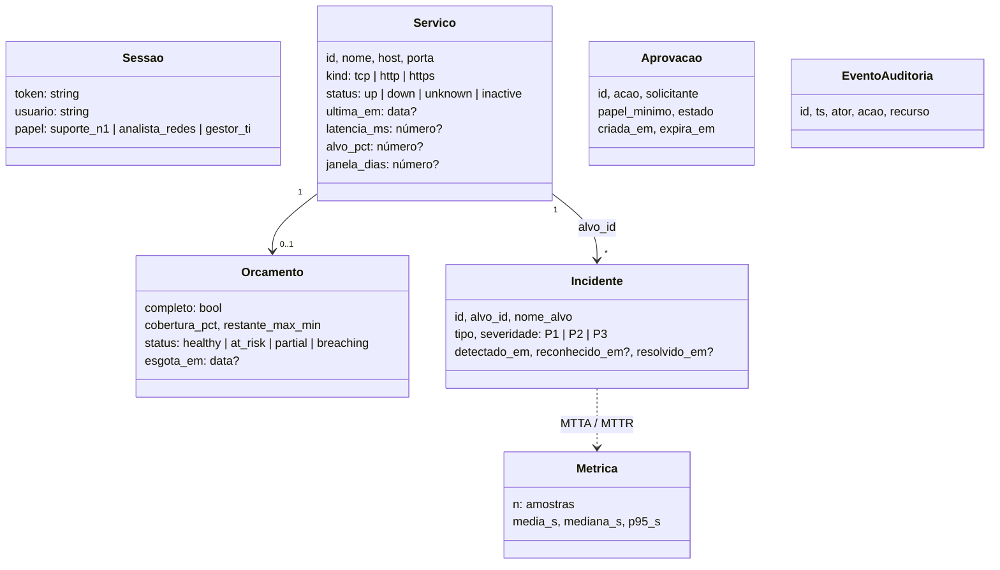

# 5. Modelagem de baixo nível do front

Este documento mostra como as peças do front se ligam: quais componentes existem, quem busca dados
e quais estados cada tela pode assumir. Ele serve para a Joyce saber onde mexer sem quebrar a
integração e serve ao TCC como modelagem do frontend.

## 5.1 Árvore de componentes

**Separação importante para o design system.** Os componentes `*Content`, `IncidentMetrics` e
`ApprovalItem` só recebem dados por props e desenham, sem chamar a API. Os componentes `*Page`
buscam os dados. A Joyce trabalha principalmente nos primeiros. Os testes de `OperationalPages.test.jsx`
renderizam esses componentes com dados fixos, e o mesmo padrão serve para novos componentes.

## 5.2 Camadas e responsabilidades

| Peça | Responsabilidade |
|---|---|
| `api.js` | Monta a requisição com token Bearer, aplica tempo limite de 18 s e traduz códigos HTTP em mensagens em português |
| `useResource(path)` | Busca um recurso (GET) e devolve `{ data, error, loading, refresh }`; cancela ao sair da tela |
| `useActionRequest()` | Executa ações (POST) e cancela se o usuário sai da tela antes da resposta |
| `useEvents()` | Mantém o fluxo de tempo real (SSE), reconecta com espera progressiva e avisa as telas para recarregar |
| `src/mock/` | Substitui a API inteira quando `VITE_MOCK=1`; não entra no build de produção |

## 5.3 Estados de uma tela de dados

Toda tela que usa `useResource` passa pelos mesmos estados. O design precisa ter uma aparência
definida para cada um:

| Estado | Componente atual | Texto | Cenário mock |
|---|---|---|---|
| Carregando | `ResourceState` | "Carregando dados…" | `?cenario=lento` |
| Vazio | `.empty` | "Nenhum serviço cadastrado…", "Nenhum incidente registrado." | `?cenario=vazio` |
| Erro | `ResourceState` + `.error` | mensagem da API + "Tentar novamente" | `?cenario=erro` |
| Sem permissão | `.error` | "Seu perfil não tem permissão para esta operação." | — |
| Com dados | `*Content` | — | padrão |

## 5.4 Mensagens de erro (vêm de `api.js`)

| Código | Mensagem exibida |
|---|---|
| 401 | Sessão ausente, expirada ou credenciais inválidas. Entre novamente. |
| 403 | Seu perfil não tem permissão para esta operação. |
| 409 | O registro mudou ou a decisão não é permitida. Atualize os dados antes de tentar novamente. |
| 422 | Confira os dados informados. |
| 429 | Muitas tentativas. Aguarde antes de tentar novamente. |
| outros / rede | A API está indisponível no momento. / Não foi possível conectar à API. |

Os textos podem ser revisados pela Joyce; a regra é manter uma mensagem por código e nenhuma em inglês.

## 5.5 Sequência: abrir uma área e receber atualização em tempo real

## 5.6 Sequência: ação com conflito (dois analistas no mesmo incidente)

## 5.7 Modelo de dados visto pelo front

O banco completo (tabelas `alvos`, `medicoes`, `slo`, `incidentes`, `eventos_operacionais`…) está em
`persistence/operational_models.py` e em `engenharia/docs/08-estado-operacional.md`. O front não acessa
o banco: só recebe o recorte acima pela API.
