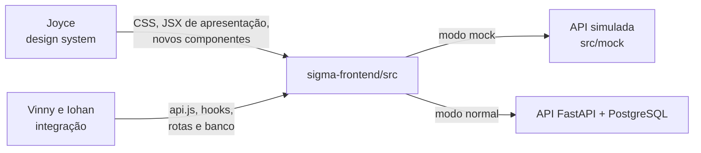

# Design system do SIGMA — material de apoio

Responsável pelo design system: **Joyce**. Integração com API e banco: **Vinny e Iohan**.

Esta pasta reúne o necessário para evoluir o visual do painel sem depender da API,
do PostgreSQL ou da chave de IA. O front roda em **modo mock**: a API é simulada
no navegador com dados fictícios no mesmo formato da API real. O que funcionar no
mock funciona com a API real, desde que o contrato da seção 6 seja respeitado.

## Por onde começar

| Ordem | Documento | Para quê |
|---|---|---|
| 1 | [Instalação só do front](01-instalacao-front.md) | Rodar o painel em 5 minutos, só com Node.js |
| 2 | [Estado atual do front](02-estado-atual.md) | Telas, capturas, arquivos e pontos a melhorar |
| 3 | [Tokens e componentes](03-tokens-e-componentes.md) | Cores, tipografia, espaçamentos e regras de acessibilidade |
| 4 | [Fluxos de usuário](04-fluxos-de-usuario.md) | O caminho de cada perfil pelo sistema |
| 5 | [Modelagem de baixo nível](05-modelagem-baixo-nivel.md) | Componentes, estados de tela e sequências com a API |
| 6 | [Contrato da API para o front](06-contrato-api-front.md) | Quais dados cada tela recebe e envia |
| 7 | [Exemplo: protótipo do Vinny](exemplo/) | 106 telas no FigCraft: a referência visual de onde queremos chegar |
| 8 | [Identidade visual](identidade-visual/) | Logotipo, paletas de cores e contraste de cada combinação |

Os diagramas estão em Mermaid: o GitHub os desenha direto na página.

## Divisão do trabalho



**Joyce pode alterar livremente:**

- `sigma-frontend/src/App.css` e `index.css` (ou dividi-los em arquivos por componente);
- a marcação e as classes em `App.jsx`, `Operations.jsx`, `OperationalPages.jsx` e `Diagnostic.jsx`;
- novos componentes visuais em `sigma-frontend/src/` (por exemplo `components/Badge.jsx`);
- textos de interface, ícones e imagens em `src/assets/` e `public/`;
- os dados de exemplo em `src/mock/data.js`, para testar casos visuais (nome longo, muitos itens).

**Fica com a integração (combinar antes de mudar):**

- `src/api.js`, `useResource.js`, `useEvents.js`, `useActionRequest.js`;
- nomes de campos vindos da API (`servicos`, `orcamento`, `incidentes`…), rotas e regras de perfil;
- `src/mock/mockApi.js`, que imita as regras da API.

Se uma tela nova precisar de um dado que a API ainda não envia, adicione-o primeiro
em `src/mock/data.js`, use-o na tela e abra uma issue descrevendo o campo. A integração
cria o campo na API com o mesmo nome e formato.

## Regras que não podem ser quebradas

As regras abaixo são cobradas pelos testes e pela banca, porque o sistema é de um hospital:

1. **Estado nunca só por cor.** Todo badge tem texto ("Disponível", "Indisponível", "Sem dados recentes").
2. **Ausência de dado não é disponibilidade.** "Sem dados recentes" não pode parecer verde.
3. **Contraste mínimo WCAG AA** (4,5:1 para texto) nos dois temas. O CI roda o axe e reprova o PR.
4. **Foco de teclado visível** em todo elemento clicável.
5. **Textos em português** e mensagens de erro explícitas: carregando, vazio e erro sempre têm texto.

## Como entregar uma alteração

```bash
git switch develop
git pull --ff-only origin develop
git switch -c feature/ds-nome-curto
# trabalhar com: npm run dev:mock
cd sigma-frontend
npm run lint
npm test
npm run build
git push -u origin feature/ds-nome-curto
```

Abra o PR para `develop`, conforme o [Git Flow](../doc/gitflow.md), com capturas antes e depois
nos dois temas. Se um teste falhar porque o texto de um botão mudou, avise no PR. Os testes
procuram elementos pelo texto visível, e a integração ajusta o teste junto.
