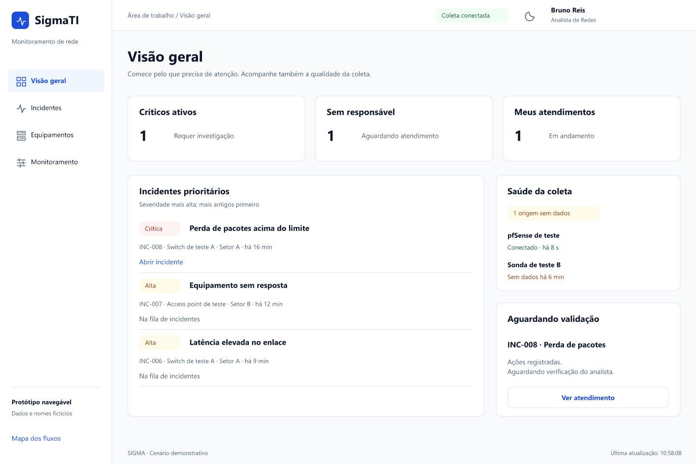

# 7. Exemplo: protótipo de telas feito pelo Vinny

Protótipo navegável do SIGMA feito no **FigCraft** em 18/10/2026. São 106 telas em 11 páginas,
com jornadas por perfil, biblioteca de componentes, tokens claro/escuro, estados de erro e
versões para celular, tablet e desktop. É a **referência visual de onde queremos chegar**, não a
descrição do que já existe (para isso, veja o [estado atual](../02-estado-atual.md)).

## Como abrir

| Arquivo | Para quê | Precisa de |
|---|---|---|
| [`review.html`](review.html) | Galeria com todas as telas, busca e imagem em tamanho original | Só o navegador: baixe a pasta e abra o arquivo |
| [`previews/`](previews/) | Uma imagem PNG por tela (1440 px no desktop) | Nada; o GitHub mostra direto |
| `sigma-fluxos.figcraft` | Arquivo editável, com navegação entre telas e modo apresentação | Aplicativo FigCraft 0.7 (peça o instalador ao Vinny) |
| [`handoff.md`](handoff.md) | Descrição das páginas, fluxos e regras do protótipo | — |
| [`tokens.css`](tokens.css) / [`tokens.json`](tokens.json) | Cores do protótipo exportadas, nos modos Claro e Escuro | — |
| [`MASTER.md`](MASTER.md) | Regras visuais de uma versão experimental anterior (17/10) | Os caminhos citados nele não existem neste repositório |

Telas boas para começar: [login](previews/login.png) · [visão geral N1](previews/overview-n1.png) ·
[fila de incidentes](previews/queue-analyst.png) · [detalhe do incidente](previews/incident-analyst.png) ·
[biblioteca de componentes](previews/library.png) · [estados de erro](previews/states.png) ·
[saúde](previews/health.png) · [auditoria](previews/audit.png) · [celular](previews/mobile-summary.png) ·
[tema escuro](previews/overview-dark.png).

## O que muda em relação ao painel atual

| Tema | Painel atual (`develop`) | Protótipo |
|---|---|---|
| Navegação | Abas horizontais | Menu lateral com ícones; vira menu expansível abaixo de 1024 px |
| Fonte | `system-ui` | Segoe UI (com `system-ui` de reserva) |
| Cor principal | `#12568e` / `#91caff` | `#1D4ED8` (claro) / `#60A5FA` (escuro) |
| Estados | Badge com borda colorida | Etiqueta com fundo suave (vermelho, âmbar, verde) e texto |
| Celular | Tabelas com rolagem horizontal | Tabelas viram cartões; detalhe em abas |
| Botões | Raio 6 px | Raio 8 px, altura 44 px, variante destrutiva vermelha |
| Espaçamento | Sem escala formal | Escala 4 · 8 · 12 · 16 · 24 · 32 · 48 |

## O que dá para fazer agora e o que depende de API nova

O protótipo imagina funcionalidades que a API ainda não tem. Use esta tabela para decidir a ordem:
o que está em **Só front** pode ser feito já, com `npm run dev:mock`. O resto precisa de uma issue
para o Vinny e o Iohan antes, seguindo o [contrato da API](../06-contrato-api-front.md#como-pedir-um-dado-novo).

| Área do protótipo | Situação na API | Classificação |
|---|---|---|
| Identidade visual: tokens, menu lateral, cabeçalho, botões, etiquetas de estado, tema escuro, responsivo | Não depende da API | **Só front** |
| Login e erro de login | `POST /api/auth/login` | **Só front** |
| Primeiro acesso, ajuda de login | Não existe | API nova |
| Saúde dos serviços | `GET /api/eng/saude` | **Só front** |
| "Saúde da coleta" na visão geral | `GET /api/eng/coleta/status` existe (Analista+), mas o painel não usa | Integração simples |
| Lista de incidentes, severidade, reconhecer e resolver | `GET /incidentes/resumo`, `POST …/reconhecer`, `…/resolver` | **Só front** |
| Assumir, registrar ação, escalar, pedir validação, reabrir, linha do tempo, responsável | Não existe; a API só tem Aberto → Reconhecido → Resolvido | API nova (mudança de modelo) |
| Diagnóstico com IA dentro do incidente, pergunta livre | Existe só `POST /api/alertas` avulso; não há chat nem vínculo com incidente | API nova |
| "Conteúdo generalizado" enviado à IA | `dados_enviados_nuvem` já vem na resposta | **Só front** |
| Equipamentos (lista, detalhe, cadastro) | `GET/POST/PATCH /api/eng/alvos` existem; o painel não usa | Integração simples |
| Auditoria | `GET /api/eng/auditoria/*` | **Só front** |
| Usuários (lista e cadastro) | `GET/POST /api/usuarios` existem, ainda em memória | Integração simples |
| Desativar e redefinir usuário, origens, rotação e revogação de credenciais | Não existe ou é só esboço (`/api/chaves/rotacao` não faz nada real) | API nova |
| Relatórios e agendamentos | `GET /api/relatorios` devolve lista vazia; o envio será pelo n8n | API nova |
| Estados de erro, vazio, sessão expirada, coleta atrasada | Já reproduzíveis com `?cenario=` no mock | **Só front** |

Ponto de atenção: o painel atual tem **Aprovações "quatro olhos"** (uma pessoa pede, outra decide),
e o protótipo não tem essa área. Ela continua obrigatória e precisa ganhar o visual novo também.

## Sugestão de ordem para a Joyce

1. **Fundação:** trazer as cores, a fonte, a escala de espaço e os botões do protótipo para os tokens do
   painel (ver [tokens e componentes](../03-tokens-e-componentes.md)).
2. **Estrutura:** menu lateral, cabeçalho com usuário e tema, e etiquetas de estado.
3. **Telas que já têm dados:** Saúde, Incidentes, Aprovações, Auditoria e Diagnóstico com o visual novo,
   incluindo celular e tema escuro.
4. **Depois, junto com a integração:** visão geral com contadores, equipamentos e as telas que dependem de API nova.

## Cuidados antes de copiar do protótipo

- **Borda de campo com pouco contraste.** A cor `--line` do protótipo (`#DCE3ED` claro, `#304157` escuro)
  tem 1,3:1 e 1,6:1 sobre a superfície. Para separadores decorativos não há problema, mas a **borda de
  campos de formulário** precisa de 3:1 (WCAG 1.4.11). Use uma cor mais forte nos campos.
  As cores de texto e de estado do protótipo passam: todas acima de 5:1.
- **Sem transição nas cores de tema.** O `MASTER.md` sugere transições de 180 ms. No painel atual uma
  transição já reprovou o CI por contraste intermediário. Troque o tema sem animar cores.
- **Textos honestos.** Mantenha frases como "Sem dados recentes" e "Até X min" do painel atual; elas são regras
  de negócio (ver [PRODUCT.md](../../PRODUCT.md)).
- **Dados fictícios.** Nomes, IPs e o incidente INC-008 do protótipo são inventados.
