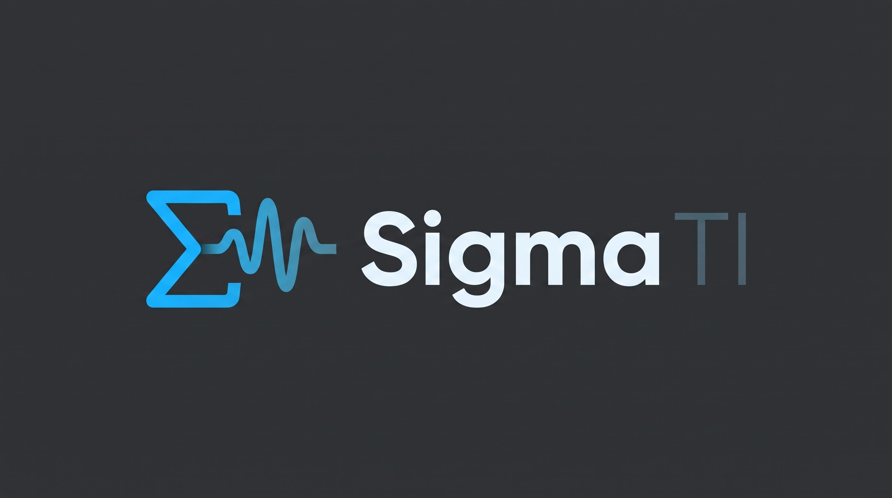
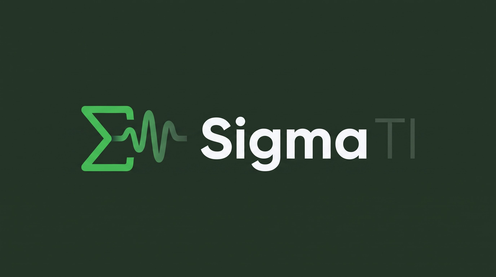

# 8. Identidade visual: logotipo e paletas

Material de marca enviado pelo Vinny em 21/10/2026. O logotipo tem duas variantes de cor (azul e verde),
e cada uma tem uma paleta. **A variante oficial ainda não foi escolhida**: essa decisão faz parte do
trabalho do design system.

| Variante azul | Variante verde |
|---|---|
|  |  |
| [Paleta azul](paleta-azul.png) | [Paleta verde](paleta-verde.png) |

Símbolo isolado (verde), para ícone, favicon e espaços pequenos: [simbolo-sigmati-verde.jpg](simbolo-sigmati-verde.jpg).

## Descrição do logotipo (texto original)

A identidade visual do Sigma TI foi desenvolvida para transmitir alta confiabilidade, estabilidade e
modernidade tecnológica, refletindo a transição do suporte reativo para uma arquitetura proativa de
observabilidade em saúde pública. O conceito funde a precisão matemática do símbolo Σ (somatório e
integração de métricas de Zabbix, Grafana e n8n) à fluidez de um pulso de dados em tempo real.

### Paleta de cores estratégica

| Cor | HEX | RGB | CMYK | Psicologia e função técnica |
|---|---|---|---|---|
| Deep Tech Navy | `#0F172A` | 15, 23, 42 | 88, 77, 44, 52 | Fundo principal. Transmite solidez, autoridade institucional e estabilidade de infraestrutura. Cumpre o padrão WCAG AAA para contraste de texto. |
| Signal Cyan | `#0EA5E9` | 14, 165, 233 | 76, 22, 0, 0 | Cor de ação / fluxo. Representa a velocidade do tráfego de dados, automação contínua e inovação visual nos dashboards. |
| Uptime Green | `#10B981` | 16, 185, 129 | 77, 0, 63, 0 | Status operacional. Traz o sentimento de saúde do sistema, estabilidade e meta atingida (99,5% de disponibilidade). |
| Pure White | `#F8FAFC` | 248, 250, 252 | 2, 1, 0, 0 | Leitura e contraste. Garante legibilidade técnica e limpeza visual, evitando fadiga cognitiva em relatórios. |

## Paletas das imagens (Adobe Color)

| Paleta azul | | Paleta verde | |
|---|---|---|---|
| `#1AB2FF` | símbolo do logotipo azul | `#41BA50` | símbolo do logotipo verde |
| `#3D9CCC` | | `#4A8751` | |
| `#4D7F99` | "TI" do logotipo azul | `#3F5442` | "TI" do logotipo verde |
| `#475C66` | | `#2B332C` | |
| `#2E3133` | fundo do logotipo azul | `#213323` | fundo do logotipo verde |

## Atenção: há três conjuntos de cores diferentes

| Origem | Azul de ação | Fundo escuro | Verde |
|---|---|---|---|
| Descrição do logotipo | `#0EA5E9` | `#0F172A` | `#10B981` |
| Imagens do logotipo / Adobe Color | `#1AB2FF` | `#2E3133` | `#41BA50` |
| Protótipo FigCraft ([exemplo](../exemplo/)) | `#1D4ED8` / `#60A5FA` | `#0B1220` | `#166534` / `#86EFAC` |

Os três são parecidos, mas não iguais. A primeira tarefa da Joyce é escolher **um** conjunto (ou derivar um a
partir do logotipo) e transformá-lo nos tokens do painel. Um ponto importante: se a marca for verde, o verde
de marca não pode se confundir com o verde de estado "Disponível". Os dois precisam de tons diferentes, e o
estado continua com texto.

## Contraste calculado (WCAG 2.1)

Texto normal exige 4,5:1; texto grande, ícones e bordas de campo exigem 3:1.

| Combinação | Contraste | Pode usar para |
|---|---|---|
| `#F8FAFC` sobre `#0F172A` (branco sobre navy) | 17,1 | Qualquer texto (AAA, confirma a descrição) |
| `#0EA5E9` sobre `#0F172A` (ciano sobre navy) | 6,4 | Texto, links e ícones no tema escuro |
| Texto branco sobre botão `#0EA5E9` | **2,8** | **Não serve.** Use texto escuro (`#0F172A`) no botão ciano, ou um ciano mais escuro |
| `#10B981` sobre branco | **2,5** | **Não serve** como texto no tema claro; só como fundo com texto escuro ou como detalhe com texto ao lado |
| `#10B981` sobre `#0F172A` | 7,0 | Texto de estado no tema escuro |
| `#1AB2FF` sobre `#2E3133` | 5,5 | Texto e ícones no tema escuro |
| Texto branco sobre `#1AB2FF` | **2,4** | **Não serve.** Use texto `#2E3133` (5,5) |
| `#41BA50` sobre `#213323` | 5,4 | Texto e ícones no tema escuro |
| `#41BA50` sobre branco | **2,5** | **Não serve** como texto no tema claro |
| `#4D7F99` e `#4A8751` sobre branco | 4,4 e 4,3 | Só texto grande (≥ 24 px, ou 19 px em negrito) e ícones |
| `#475C66` e `#3F5442` sobre branco | 7,0 e 8,2 | Texto secundário no tema claro |

Resumo: as cores vivas da marca (ciano, azul e verde) funcionam muito bem no **tema escuro**. No **tema claro**,
use a versão escura da cor para texto e botões.

## Pendências do material

- **Logotipo em vetor (SVG).** Os arquivos atuais são imagens JPG com fundo. Para o cabeçalho do painel e para o
  favicon é preciso um SVG com fundo transparente, nas versões para tema claro e escuro. Pode ser redesenhado
  a partir destas imagens.
- **Fonte do logotipo.** A fonte de "Sigma" não está identificada; se for adotada no painel, precisa de licença livre
  e de arquivo local (o projeto não carrega fontes de servidores externos).
- **Escolha da variante** (azul ou verde) e do conjunto de cores, conforme a seção acima.
- Depois de decidido, atualizar `DESIGN.md` na raiz do projeto, que é a referência citada no TCC.

## Proposta de marca e paleta (DS-03), aguardando decisão

Esta pasta recebeu duas propostas para a identidade do painel. Nenhuma foi aprovada nem aplicada ao painel. A decisão é da reunião de equipe.

- [decisoes.md](decisoes.md): três opções lado a lado, papéis de cor, tabelas de contraste e quadro "Registro da decisão" para preencher na reunião.
- [prancha-identidade-v4.html](prancha-identidade-v4.html): prancha da identidade v4 (abrir no navegador).