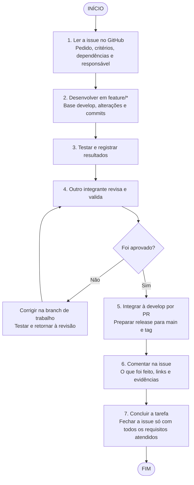

# Fluxo de trabalho do TCC — SIGMA

Este é o fluxo da equipe para atender às issues do GitHub. Seguimos o
[Git Flow do SigmaTI](gitflow.md): `feature/*` e `fix/*` partem da `develop`
e retornam por PR revisado. Uma `release/*` prepara a integração aprovada
à `main`, com tag de versão e retorno das correções à `develop`.
`hotfix/*` parte da `main` para urgências e retorna também à `develop`.

## Fluxo



Durante todo o processo, documente **o que mudou, por que mudou, as decisões
tomadas, como foi testado, os resultados e as pendências**. Use comentários na
issue, mensagens de commit e a documentação do repositório; o registro final
consolida as evidências produzidas durante o trabalho.

## Como trabalhar uma issue

1. **Entenda o pedido completo.** Leia título, corpo, critérios de aceite,
   comentários e especificações vinculadas. O checklist resume o pedido, mas
   não elimina requisitos descritos no corpo. Confira as dependências e registre
   um responsável pela tarefa e um colega que fará a revisão.
2. **Relacione issue e planejamento.** Identifique qual cartão da sprint atende
   a qual parte da issue. Uma issue pode exigir várias tarefas; concluir um cartão
   não significa cumprir a issue inteira. Registre o escopo e as pendências antes
   de começar e mova o cartão para **Em andamento**.
3. **Desenvolva em uma branch por tarefa.** Atualize a `develop`, crie
   `feature/nome` para funcionalidades ou `fix/nome` para correções. Preserve
   alterações de outros integrantes e faça commits com referência à issue.
4. **Teste e produza evidências.** Execute as verificações dos critérios de aceite
   e as verificações afetadas pela mudança. Registre comandos, ambiente, resultado
   esperado, resultado obtido e links para commits, testes ou arquivos. Use dados
   fictícios; não inclua chaves, senhas ou dados reais do hospital nas evidências.
5. **Peça revisão a outro integrante.** Abra PR para `develop` e mova o cartão
   para **Revisão e testes**. O colega confere o pedido completo e os resultados.
   Corrija os achados na branch de trabalho e execute novamente as verificações
   afetadas antes da aprovação. Integre somente com revisão e CI aprovados.
6. **Prepare uma release do conjunto aprovado.** Valide na `develop`, crie
   `release/X.Y.Z`, congele funcionalidades e registre o aceite. Após aprovação,
   integre à `main`, marque `vX.Y.Z` e leve as correções da release à `develop`.
   O procedimento completo, incluindo urgências, está em [Git Flow](gitflow.md).
7. **Registre a entrega e atualize o quadro.** Comente na issue o que foi feito,
   os links, a revisão e as evidências. Marque os critérios realmente atendidos.
   Mova a tarefa para **Concluído** quando seu escopo estiver aprovado e entregue.
   Feche a issue somente quando todos os seus requisitos estiverem atendidos;
   se a entrega for parcial, deixe-a aberta e identifique as tarefas restantes.

## Colunas do quadro

| Coluna | Quando usar |
|---|---|
| A fazer | Tarefa identificada, com escopo, responsável e dependências registrados. |
| Em andamento | Desenvolvimento na branch da tarefa ou correção dos achados em execução. |
| Revisão e testes | Alteração pronta para validação e revisão por outro integrante, com evidências disponíveis. |
| Concluído | Escopo da tarefa aprovado e entregue; a issue só fecha se seus requisitos completos também estiverem atendidos. |

## Exemplos de comentários

Os modelos abaixo são exemplos para a equipe preencher. Publicar este documento
não cria comentários nas issues.

**Comentário inicial:**

```text
Iniciando a tarefa [Kxx], vinculada à issue #[número].
Responsável: [nome]. Revisor: [outro integrante].
Escopo desta entrega: [parte do pedido que será atendida].
Critérios a validar: [critérios do corpo e do checklist].
Dependências e pendências: [listar ou indicar nenhuma].
Trabalho em feature/nome, com PR para develop; evidências serão registradas nesta issue e na documentação.
```

**Comentário final:**

```text
Entrega da tarefa [Kxx] vinculada à issue #[número].
O que mudou e por quê: [resumo e decisões].
Commits / integração / documentação: [links].
Testes: [comandos, ambiente e resultados].
Evidências: [links].
Revisão: [nome do colega e registro da aprovação].
Critérios atendidos: [listar].
Pendências: [listar ou indicar nenhuma].
Situação da issue: [manter aberta por entrega parcial / fechar após atender tudo].
```

## Aplicação às issues atuais

Esta tabela orienta a conferência do pedido; **não declara que os critérios já
foram implementados ou validados**. A descrição atual de cada issue no GitHub
continua sendo a referência para a entrega.

| Issue | Conferências necessárias |
|---|---|
| [#2 — Docker Compose](https://github.com/Solution-Explores/SigmaTI/issues/2) | `docker compose config --quiet` aprovado localmente e no CI; arquivo sem marcadores de conflito; README e documentação da stack coerentes com os serviços mantidos. |
| [#3 — Credenciais, portas e imagens](https://github.com/Solution-Explores/SigmaTI/issues/3) | `.env.example` presente e `.env` ignorado; nenhuma senha literal versionada; imagens com versões fixadas e sem tags `latest`; conferir também o corpo: banco na rede interna, portas restritas, n8n acessível pela gerência/VPN e política de atualização documentada. |
| [#4 — Configuração e chamada à IA](https://github.com/Solution-Explores/SigmaTI/issues/4) | Sem segredo no código e API falhando ao iniciar sem chave; origem não autorizada recusada; teste com provedor simulado demonstrando timeout de até 15 s e erro público genérico; conferir também chamada assíncrona, modelo e origens por ambiente e registro dos detalhes de falha em log. |

Por exemplo, a K02 cobre a configuração por ambiente da issue #4. Só essa entrega
não permite fechar a issue: ainda é necessário validar os demais critérios,
incluindo chamada assíncrona, timeout e tratamento de erros.

[Voltar ao README](../README.md)
