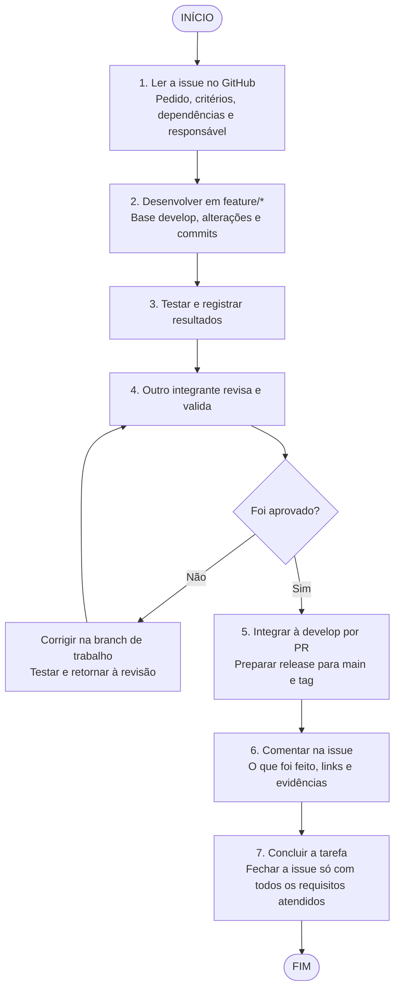

# Fluxo de trabalho do TCC

Como a equipe atende uma issue do GitHub, da leitura ao fechamento. O fluxo segue o [Git Flow](gitflow.md): `feature/*` e `fix/*` partem da `develop` e voltam por PR revisado.



Documente sempre o que mudou, por quê, as decisões, como foi testado, os resultados e as pendências. Use comentários na issue, mensagens de commit e a documentação do repositório.

## Passo a passo

1. **Entenda o pedido completo.** Leia título, corpo, critérios de aceite, comentários e specs vinculadas. O checklist resume o pedido, mas não substitui o corpo da issue. Confira as dependências e registre um responsável e um colega revisor.
2. **Ligue a issue ao planejamento.** Veja qual cartão da sprint atende qual parte da issue. Uma issue pode ter várias tarefas, e concluir um cartão não cumpre a issue inteira. Registre o escopo e as pendências e mova o cartão para **Em andamento**.
3. **Trabalhe em uma branch por tarefa.** Atualize a `develop` e crie `feature/nome` (funcionalidade) ou `fix/nome` (correção). Preserve o trabalho dos colegas e referencie a issue nos commits.
4. **Teste e registre evidências.** Rode as verificações dos critérios de aceite e as afetadas pela mudança. Registre comandos, ambiente, resultado esperado, resultado obtido e links. Use dados fictícios. Nunca inclua chaves, senhas ou dados reais do hospital.
5. **Peça revisão.** Abra o PR para `develop` e mova o cartão para **Revisão e testes**. O colega confere o pedido completo e os resultados. Corrija os achados na mesma branch e repita as verificações afetadas. Integre só com revisão e CI aprovados.
6. **Prepare a release.** Valide na `develop`, crie `release/X.Y.Z`, congele funcionalidades e registre o aceite. Depois da aprovação, integre à `main`, crie a tag `vX.Y.Z` e leve as correções de volta à `develop`. Detalhes e urgências (`hotfix/*`) estão no [Git Flow](gitflow.md).
7. **Registre a entrega.** Comente na issue o que foi feito, com links, revisão e evidências. Marque os critérios atendidos e mova a tarefa para **Concluído**. Feche a issue só quando todos os requisitos estiverem atendidos. Se a entrega for parcial, deixe a issue aberta e liste o que falta.

## Colunas do quadro

| Coluna | Quando usar |
|---|---|
| A fazer | Tarefa identificada, com escopo, responsável e dependências registrados. |
| Em andamento | Desenvolvimento na branch da tarefa, ou correção dos achados da revisão. |
| Revisão e testes | Alteração pronta para revisão por outro integrante, com evidências. |
| Concluído | Escopo da tarefa aprovado e entregue. A issue só fecha se todos os seus requisitos também estiverem atendidos. |

## Modelos de comentário

Preencha os campos entre colchetes.

Comentário inicial:

```text
Iniciando a tarefa [Kxx], vinculada à issue #[número].
Responsável: [nome]. Revisor: [outro integrante].
Escopo desta entrega: [parte do pedido que será atendida].
Critérios a validar: [critérios do corpo e do checklist].
Dependências e pendências: [listar ou indicar nenhuma].
Trabalho em feature/nome, com PR para develop; evidências serão registradas nesta issue e na documentação.
```

Comentário final:

```text
Entrega da tarefa [Kxx] vinculada à issue #[número].
O que mudou e por quê: [resumo e decisões].
Commits / integração / documentação: [links].
Testes: [comandos, ambiente e resultados].
Evidências: [links].
Revisão: [nome do colega e registro da aprovação].
Critérios atendidos: [listar].
Pendências: [listar ou indicar nenhuma].
Situação da issue: [manter aberta por entrega parcial / fechar após atender tudo].
```

## Conferências por issue

A tabela orienta a conferência do pedido. Ela não declara que os critérios já foram implementados ou validados. A descrição atual da issue no GitHub é a referência.

| Issue | O que conferir |
|---|---|
| [#2 Docker Compose](https://github.com/Solution-Explores/SigmaTI/issues/2) | `docker compose config --quiet` passa localmente e no CI. O arquivo não tem marcadores de conflito. README e stack descrevem os serviços mantidos. |
| [#3 Credenciais, portas e imagens](https://github.com/Solution-Explores/SigmaTI/issues/3) | `.env.example` existe e `.env` é ignorado. Nenhuma senha literal no repositório. Imagens com versão fixa, sem `latest`. Banco na rede interna, portas restritas, n8n acessível só pela gerência ou VPN, política de atualização documentada. |
| [#4 Configuração e chamada à IA](https://github.com/Solution-Explores/SigmaTI/issues/4) | Sem segredo no código, e a API falha ao iniciar sem chave. Origem não autorizada é recusada. Teste com provedor simulado mostra timeout de até 15 s e erro público genérico. Chamada assíncrona, modelo e origens por ambiente, e detalhes de falha só no log. |

Exemplo: a K02 cobre a configuração por ambiente da issue #4. Ela sozinha não fecha a issue, porque faltam a chamada assíncrona, o timeout e o tratamento de erros.

[Voltar ao README](../../README.md)
