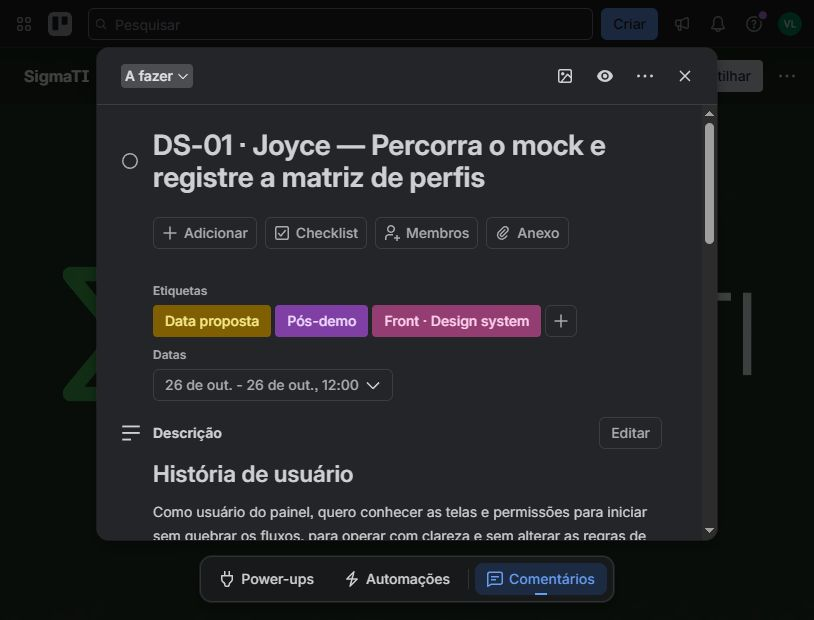

# Trello SigmaTI — atualização de 21/10/2026

[Certo] Quadro atualizado: https://trello.com/b/vswV1j1T/sigmati . Foram criados **56 cartões**: 42 tarefas DS da Joyce, oito rascunhos de integração/API, quatro marcos da demonstração e duas atividades de organização pós-demo. Os **18 cartões ativos anteriores** receberam atualização factual de acompanhamento. O quadro tem **87 cartões: 74 ativos e 13 históricos em Concluído**.

## Conferência realizada

- Os 74 cartões ativos foram conferidos na interface após recarregar o Trello: todos têm descrição, data e comentário publicado. As listas ativas têm 20 cartões no Backlog, 50 em A fazer, zero em andamento e quatro em Revisão e testes.
- Joyce: DS-01–34 em A fazer; DS-35–42 no Backlog, com bloqueio de integração. Todos têm história, responsável/revisor por escrito, links de issues, orientação de acompanhamento e referência ao plano completo anexado no [DS-01](https://trello.com/c/Wrc04SSu). O arquivo anexado registra arquivos, passos, dependências e critérios específicos das 42 tarefas.
- Etiquetas criadas e usadas: **Demonstração 24/10**, **Front · Design system**, **Data proposta**, **Bloqueado · Integração** e **Pós-demo**. As anteriores foram preservadas; no #5, Infraestrutura foi substituída por API e Data proposta.
- Vinny e Iohan foram vinculados às atividades existentes e aos novos marcos/rascunhos de integração; seus papéis de execução/revisão estão descritos. O Trello não tem um campo nativo separado de revisor neste fluxo.
- A verificação final do GitHub manteve #43 aberto em `8662ea9`, alvo `develop`, e #44 aberto em `ddd4840`, alvo `fix/base-issues`; nenhum deles tem decisão de aprovação independente registrada. #41/#42 continuam abertos e pós-demo. Não houve escrita no GitHub nesta atualização.
- Nenhum cartão planejado foi declarado em execução ou concluído; os 13 cartões históricos não foram movidos ou apagados. Nenhum código foi alterado nesta atualização do Trello.

## Datas e significado

Todos os horários abaixo usam UTC−4, conforme o plano da demonstração.

| Atividade | Data | Significado |
|---|---|---|
| Revisão #43 por Iohan | 22/10 até 8h | Prazo do plano; integração por Vinny depois dos achados |
| Revisão #44 por Iohan | 22/10 após 22h | Após merge #43, mudança de alvo e CI, executados pelo integrador |
| Aceite, dois ensaios, contingência e slides | 23/10 antes das 18h | Ainda pendentes; candidatos validados em VM não substituem aceite integrado |
| Congelamento do SHA | **23/10 às 18h** | Marco fixo |
| Roteiro independente por Iohan | 23/10 após 22h | A data nativa de 22h marca início da janela, não horário de término |
| Smoke | **24/10 às 7h30** | Marco fixo |
| Demonstração | **24/10 às 9h** | Marco fixo |
| Início da Joyce | **26/10, proposto** | Confirmado pelo usuário como proposta; execução ainda não confirmada pela Joyce |
| DS-01 / DS-02 | 26/10, 12h / 18h | Estimativas iniciais propostas |
| DS-03 / DS-04 / DS-05 | 27/10 18h / 28/10 18h / 29/10 12h | Estimativas propostas, sujeitas à capacidade e revisão |
| DS-06 / DS-07 | 03/11, 12h / 18h | Estimativas propostas |
| DS-08 / DS-09 / DS-10 | 04/11 18h / 05/11 18h / 06/11 12h | Estimativas propostas |
| DS-11–34 | 06/11 às 18h | **Revisão do planejamento restante; não prazo de conclusão dessas 24 tarefas** |
| DS-35–42 e API-01–08 | 26/10 às 18h | **Revisão dos bloqueios/contratos; não prazo de implementação** |
| Organização documental | 27/10 às 18h | Revisão proposta do planejamento/PR após a demo |
| Estrutura de diretórios | 27/10 às 18h | Meta do plano, condicionada a CI, regressão e revisão independente |
| #45 / #46 | 27/10 às 18h | Triagem pós-demo; não bloqueiam a apresentação |
| #5, #13, #25 físico e release | 03/11 às 18h | Proposta sujeita ao orientador; aceite da release em 31/10–01/11 |

O prazo final do redesign **não foi pactuado**. As datas de revisão não devem ser usadas como previsão de entrega completa.

## Evidências usadas nos comentários

- `rodada-2026-10-22b`: `ddd4840`, 489/489, carga 5/5 contra 0/5 da `develop`, atraso máximo de 0,093396 s e zero erros. P95 queda→SSE até 0,41 s refere-se ao ensaio sintético, não a homologação externa.
- `rodada-2026-10-22c`: instabilidades anteriores aos PRs; provedor 9/10 e sonda 5/10 na baseline; sonda 26/30 antes e 30/30 com shutdown. O timer do provedor atrasou até 1,263 s; a causa sistêmica exata não foi isolada.
- #25: 17 verificações de restauração em VM no mesmo host; outra máquina física continua pendente. As três rodadas de regressão/carga/diagnóstico não repetiram a restauração.
- #6/#8: **validado em VM; aceite final em 23/10**. Não se declarou merge, aprovação independente ou homologação hospitalar.

## Divergências, limites e pendências

| Item | Tratamento / pendência |
|---|---|
| O plano original exclui Joyce da preparação da demo | Respeitado: trabalho visual começa depois da demo, proposta de 26/10 autorizada pelo usuário |
| Nome informado: Joyce Yasmin; quadro tem apenas Vinny e Iohan | Não foi possível identificar uma conta inequívoca na busca. Nome registrado nos 42 cartões; **atribuição nativa à Joyce depende do @usuário/link do perfil ou da entrada dela no quadro** |
| Issue #15 encerrada; novas tarefas visuais ainda planejadas | #15 permanece referência da entrega anterior; #31 coordena a evolução. Não se reabriu #15 nem se declarou o redesign entregue |
| API-01–08 são rascunhos, não contratos aprovados | Criados no Backlog com revisão de escopo, gates e vínculos às issues existentes. Não foram criadas novas issues ou prometidas rotas nesta atualização |
| Histórico de alguns cartões excede o limite de descrição | Histórico preservado. Quando não cabia novo resumo, a situação vigente foi publicada em comentário |
| Trechos antigos do plano citam 488/488 ou rodadas ainda em andamento | Atualização usa a seção posterior e os resultados finais: 489/489 no candidato. Registros antigos não foram apagados |
| GitHub atual versus estado consolidado | A conferência final dos PRs não encontrou mudança nos heads/alvos de #43/#44. Revisão e aceite continuam pendentes |
| Conector Trello não respondeu | Atualizações e conferência executadas pelo navegador autenticado; não foram solicitadas senhas |

Os textos-base e as fontes foram salvos em `previa.md` antes das publicações correspondentes. `atualizacoes.json` contém os 17 novos comentários de atividades anteriores, além do comentário da #6 já registrado na prévia. `marcos.json` contém os textos dos 14 marcos/rascunhos. `joyce-planejado.json` preserva o escopo das 42 tarefas. `cartoes-verificados.json` contém a auditoria final dos 74 cartões ativos; `links-cartoes.json` lista os 87 cartões. `verificacao-detalhada.json` guarda a confirmação dos comentários dos 14 marcos e seus textos visíveis, incluindo registros intermediários e a confirmação final por cartão.

## Cartões ativos conferidos

| Cartão | Lista | Data nativa | Etiquetas |
|---|---|---|---|
| [DEMO — Apresentar SigmaTI ao orientador às 9h](https://trello.com/c/pTOLHID5/82-demo-apresentar-sigmati-ao-orientador-%C3%A0s-9h) | A fazer | 24 de out. | Demonstração 24/10 |
| [DEMO — Congelar e registrar SHA após aceite](https://trello.com/c/8rPHLLDJ/79-demo-congelar-e-registrar-sha-ap%C3%B3s-aceite) | A fazer | 23 de out. | Demonstração 24/10 |
| [DEMO — Executar roteiro independente no SHA congelado](https://trello.com/c/wsAdCuzy/80-demo-executar-roteiro-independente-no-sha-congelado) | A fazer | 23 de out. | Demonstração 24/10 |
| [DEMO — Smoke de sábado às 7h30](https://trello.com/c/CrvfTOsN/81-demo-smoke-de-s%C3%A1bado-%C3%A0s-7h30) | A fazer | 24 de out. | Demonstração 24/10 |
| [DS-01 · Joyce — Percorra o mock e registre a matriz de perfis](https://trello.com/c/Wrc04SSu/37-ds-01-joyce-percorra-o-mock-e-registre-a-matriz-de-perfis) | A fazer | 26 de out. - 26 de out. | Data proposta, Pós-demo, Front · Design system |
| [DS-02 · Joyce — Corrija os títulos do Diagnóstico](https://trello.com/c/6llECScF/38-ds-02-joyce-corrija-os-t%C3%ADtulos-do-diagn%C3%B3stico) | A fazer | 26 de out. - 26 de out. | Data proposta, Pós-demo, Front · Design system |
| [DS-03 · Joyce — Escolha a marca e a paleta oficial](https://trello.com/c/6hxxMEqu/39-ds-03-joyce-escolha-a-marca-e-a-paleta-oficial) | A fazer | 27 de out. - 27 de out. | Data proposta, Pós-demo, Front · Design system |
| [DS-04 · Joyce — Entregue os logotipos SVG dos dois temas](https://trello.com/c/0WqEOyMF/40-ds-04-joyce-entregue-os-logotipos-svg-dos-dois-temas) | A fazer | 28 de out. - 28 de out. | Data proposta, Pós-demo, Front · Design system |
| [DS-05 · Joyce — Defina a fonte e os direitos de uso](https://trello.com/c/66V57K8v/41-ds-05-joyce-defina-a-fonte-e-os-direitos-de-uso) | A fazer | 29 de out. - 29 de out. | Data proposta, Pós-demo, Front · Design system |
| [DS-06 · Joyce — Centralize os tokens](https://trello.com/c/QTqRuhON/42-ds-06-joyce-centralize-os-tokens) | A fazer | 3 de nov. - 3 de nov. | Data proposta, Pós-demo, Front · Design system |
| [DS-07 · Joyce — Aplique as escalas de espaço e tipografia](https://trello.com/c/iZCZ8bRy/43-ds-07-joyce-aplique-as-escalas-de-espa%C3%A7o-e-tipografia) | A fazer | 3 de nov. | Data proposta, Pós-demo, Front · Design system |
| [DS-08 · Joyce — Implemente os temas e confira contraste](https://trello.com/c/PEgyAF7W/44-ds-08-joyce-implemente-os-temas-e-confira-contraste) | A fazer | 4 de nov. | Data proposta, Pós-demo, Front · Design system |
| [DS-09 · Joyce — Extraia o botão e seus estados](https://trello.com/c/MqxhCz2e/45-ds-09-joyce-extraia-o-bot%C3%A3o-e-seus-estados) | A fazer | 5 de nov. | Data proposta, Pós-demo, Front · Design system |
| [DS-10 · Joyce — Padronize etiquetas de estado e severidade](https://trello.com/c/p3f2INN2/46-ds-10-joyce-padronize-etiquetas-de-estado-e-severidade) | A fazer | 6 de nov. | Data proposta, Pós-demo, Front · Design system |
| [DS-11 · Joyce — Extraia painéis semânticos](https://trello.com/c/WebBaVjt/47-ds-11-joyce-extraia-pain%C3%A9is-sem%C3%A2nticos) | A fazer | 6 de nov. | Data proposta, Pós-demo, Front · Design system |
| [DS-12 · Joyce — Extraia a tabela acessível](https://trello.com/c/xNyoLk8C/48-ds-12-joyce-extraia-a-tabela-acess%C3%ADvel) | A fazer | 6 de nov. | Data proposta, Pós-demo, Front · Design system |
| [DS-13 · Joyce — Extraia alertas e mensagens](https://trello.com/c/xQKcOuCM/49-ds-13-joyce-extraia-alertas-e-mensagens) | A fazer | 6 de nov. | Data proposta, Pós-demo, Front · Design system |
| [DS-14 · Joyce — Extraia vazio e carregamento](https://trello.com/c/cW0329a8/50-ds-14-joyce-extraia-vazio-e-carregamento) | A fazer | 6 de nov. | Data proposta, Pós-demo, Front · Design system |
| [DS-15 · Joyce — Extraia campos e ajuda](https://trello.com/c/WYOucKQj/51-ds-15-joyce-extraia-campos-e-ajuda) | A fazer | 6 de nov. | Data proposta, Pós-demo, Front · Design system |
| [DS-16 · Joyce — Monte cabeçalho com marca e papel](https://trello.com/c/KTUBQTxN/52-ds-16-joyce-monte-cabe%C3%A7alho-com-marca-e-papel) | A fazer | 6 de nov. | Data proposta, Pós-demo, Front · Design system |
| [DS-17 · Joyce — Organize a navegação lateral](https://trello.com/c/c8we0QdU/53-ds-17-joyce-organize-a-navega%C3%A7%C3%A3o-lateral) | A fazer | 6 de nov. | Data proposta, Pós-demo, Front · Design system |
| [DS-18 · Joyce — Adapte o menu para celular](https://trello.com/c/MBLorEaE/54-ds-18-joyce-adapte-o-menu-para-celular) | A fazer | 6 de nov. | Data proposta, Pós-demo, Front · Design system |
| [DS-19 · Joyce — Compacte os avisos da demo](https://trello.com/c/VvKXPFZ0/55-ds-19-joyce-compacte-os-avisos-da-demo) | A fazer | 6 de nov. | Data proposta, Pós-demo, Front · Design system |
| [DS-20 · Joyce — Aplique o visual ao Login](https://trello.com/c/KLL8L35C/56-ds-20-joyce-aplique-o-visual-ao-login) | A fazer | 6 de nov. | Data proposta, Pós-demo, Front · Design system |
| [DS-21 · Joyce — Reorganize a Saúde sem reinterpretar dados](https://trello.com/c/jo2gyk7c/57-ds-21-joyce-reorganize-a-sa%C3%BAde-sem-reinterpretar-dados) | A fazer | 6 de nov. | Data proposta, Pós-demo, Front · Design system |
| [DS-22 · Joyce — Transforme a Saúde em cartões no celular](https://trello.com/c/vmxaUjBc/58-ds-22-joyce-transforme-a-sa%C3%BAde-em-cart%C3%B5es-no-celular) | A fazer | 6 de nov. | Data proposta, Pós-demo, Front · Design system |
| [DS-23 · Joyce — Traduza tipos e formate durações](https://trello.com/c/a1mvCn2e/59-ds-23-joyce-traduza-tipos-e-formate-dura%C3%A7%C3%B5es) | A fazer | 6 de nov. | Data proposta, Pós-demo, Front · Design system |
| [DS-24 · Joyce — Destaque estado e ações de incidentes](https://trello.com/c/WPlJsbLy/60-ds-24-joyce-destaque-estado-e-a%C3%A7%C3%B5es-de-incidentes) | A fazer | 6 de nov. | Data proposta, Pós-demo, Front · Design system |
| [DS-25 · Joyce — Adapte incidentes para celular](https://trello.com/c/ORY6bnTH/61-ds-25-joyce-adapte-incidentes-para-celular) | A fazer | 6 de nov. | Data proposta, Pós-demo, Front · Design system |
| [DS-26 · Joyce — Reorganize a solicitação de aprovação](https://trello.com/c/msh8Cg5Y/62-ds-26-joyce-reorganize-a-solicita%C3%A7%C3%A3o-de-aprova%C3%A7%C3%A3o) | A fazer | 6 de nov. | Data proposta, Pós-demo, Front · Design system |
| [DS-27 · Joyce — Padronize decisões e bloqueios de aprovação](https://trello.com/c/JanTqFag/63-ds-27-joyce-padronize-decis%C3%B5es-e-bloqueios-de-aprova%C3%A7%C3%A3o) | A fazer | 6 de nov. | Data proposta, Pós-demo, Front · Design system |
| [DS-28 · Joyce — Separe trilhas no visual da Auditoria](https://trello.com/c/F4NAEtPR/64-ds-28-joyce-separe-trilhas-no-visual-da-auditoria) | A fazer | 6 de nov. | Data proposta, Pós-demo, Front · Design system |
| [DS-29 · Joyce — Adapte eventos de Auditoria para celular](https://trello.com/c/xXuSwiTD/65-ds-29-joyce-adapte-eventos-de-auditoria-para-celular) | A fazer | 6 de nov. | Data proposta, Pós-demo, Front · Design system |
| [DS-30 · Joyce — Aplique o visual ao formulário do Diagnóstico](https://trello.com/c/cDncFkWy/66-ds-30-joyce-aplique-o-visual-ao-formul%C3%A1rio-do-diagn%C3%B3stico) | A fazer | 6 de nov. | Data proposta, Pós-demo, Front · Design system |
| [DS-31 · Joyce — Reorganize resultado e conteúdo generalizado](https://trello.com/c/XvybhCOU/67-ds-31-joyce-reorganize-resultado-e-conte%C3%BAdo-generalizado) | A fazer | 6 de nov. | Data proposta, Pós-demo, Front · Design system |
| [DS-32 · Joyce — Capture Login, Saúde e Incidentes](https://trello.com/c/fPsMLNu9/68-ds-32-joyce-capture-login-sa%C3%BAde-e-incidentes) | A fazer | 6 de nov. | Data proposta, Pós-demo, Front · Design system |
| [DS-33 · Joyce — Capture Aprovações, Auditoria e Diagnóstico](https://trello.com/c/QMQm7SDt/69-ds-33-joyce-capture-aprova%C3%A7%C3%B5es-auditoria-e-diagn%C3%B3stico) | A fazer | 6 de nov. | Data proposta, Pós-demo, Front · Design system |
| [DS-34 · Joyce — Atualize DESIGN e o estado atual](https://trello.com/c/DcbOYYVW/70-ds-34-joyce-atualize-design-e-o-estado-atual) | A fazer | 6 de nov. | Data proposta, Pós-demo, Front · Design system |
| [ÉPICO #31 — Consolidar aceite e preparar release](https://trello.com/c/zOyTl0LP/20-%C3%A9pico-31-consolidar-aceite-e-preparar-release) | A fazer | 3 de nov. | Documentação e entrega, Pós-demo |
| [ÉPICO #31 — Finalizar README e roteiro da demonstração](https://trello.com/c/HMFmBFhp/19-%C3%A9pico-31-finalizar-readme-e-roteiro-da-demonstra%C3%A7%C3%A3o) | A fazer | 23 de out. | Demonstração 24/10, Documentação e entrega |
| [ÉPICO #31 — Manter CI e roteiro de instalação](https://trello.com/c/sTTArNVt/13-%C3%A9pico-31-manter-ci-e-roteiro-de-instala%C3%A7%C3%A3o) | A fazer | 23 de out. | Demonstração 24/10, Infraestrutura |
| [ÉPICO #31 — Plano de entrega e release](https://trello.com/c/YGVH2Pg9/25-%C3%A9pico-31-plano-de-entrega-e-release) | A fazer | 3 de nov. | Documentação e entrega |
| [ÉPICO #31 — Validar instalação limpa da demonstração](https://trello.com/c/KfknLcok/14-%C3%A9pico-31-validar-instala%C3%A7%C3%A3o-limpa-da-demonstra%C3%A7%C3%A3o) | A fazer | 23 de out. | Qualidade e testes, Demonstração 24/10 |
| [ISSUE #13 — Âncora externa, rotação HMAC e verificação agendada](https://trello.com/c/e7us28WV/33-issue-13-%C3%A2ncora-externa-rota%C3%A7%C3%A3o-hmac-e-verifica%C3%A7%C3%A3o-agendada) | A fazer | 3 de nov. | Pós-demo |
| [ISSUE #25 — Validar restauração em outra máquina física](https://trello.com/c/9zGDTCQp/34-issue-25-validar-restaura%C3%A7%C3%A3o-em-outra-m%C3%A1quina-f%C3%ADsica) | A fazer | 3 de nov. | Pós-demo |
| [ISSUE #45 — Testes instáveis (não bloqueia a demo)](https://trello.com/c/tr4WuXPv/35-issue-45-testes-inst%C3%A1veis-n%C3%A3o-bloqueia-a-demo) | A fazer | 27 de out. | Pós-demo |
| [ISSUE #5 — Anonimização e bloqueio de dados sensíveis](https://trello.com/c/WzIvGyKq/22-issue-5-anonimiza%C3%A7%C3%A3o-e-bloqueio-de-dados-sens%C3%ADveis) | A fazer | 3 de nov. | Data proposta, API |
| [ISSUES #4/#5/#6 — Executar aceite integrado da API](https://trello.com/c/z1CLDzjj/15-issues-4-5-6-executar-aceite-integrado-da-api) | A fazer | 23 de out. | Qualidade e testes, Demonstração 24/10 |
| [PÓS-DEMO — Organizar documentação e README em PR próprio](https://trello.com/c/ijKGqD5U/83-p%C3%B3s-demo-organizar-documenta%C3%A7%C3%A3o-e-readme-em-pr-pr%C3%B3prio) | A fazer | 27 de out. | Pós-demo |
| [PÓS-DEMO — Reorganizar diretórios em PR separado](https://trello.com/c/uAgIxVlR/84-p%C3%B3s-demo-reorganizar-diret%C3%B3rios-em-pr-separado) | A fazer | 27 de out. | Pós-demo |
| [API-01 — Planejar assunção concorrente [libera DS-35]](https://trello.com/c/ncMdST2J/85-api-01-planejar-assun%C3%A7%C3%A3o-concorrente-libera-ds-35) | Backlog | 26 de out. | Data proposta, Bloqueado · Integração, Pós-demo, API |
| [API-02 — Planejar escalonamento auditado [libera DS-36]](https://trello.com/c/4SQR2pIs/86-api-02-planejar-escalonamento-auditado-libera-ds-36) | Backlog | 26 de out. | Data proposta, Bloqueado · Integração, Pós-demo, API |
| [API-03 — Planejar IA contextual [libera DS-37]](https://trello.com/c/nRdm4DCn/87-api-03-planejar-ia-contextual-libera-ds-37) | Backlog | 26 de out. | Data proposta, Bloqueado · Integração, Pós-demo, API |
| [API-04 — Planejar relatórios reais [libera DS-38]](https://trello.com/c/TzZ1BZZn/88-api-04-planejar-relat%C3%B3rios-reais-libera-ds-38) | Backlog | 26 de out. | Data proposta, Bloqueado · Integração, Pós-demo, API |
| [API-05 — Planejar credenciais seguras [libera DS-39]](https://trello.com/c/utUUoA5P/89-api-05-planejar-credenciais-seguras-libera-ds-39) | Backlog | 26 de out. | Data proposta, Bloqueado · Integração, Pós-demo, API |
| [API-06 — Integrar alvos existentes ao cliente/mock [libera DS-40]](https://trello.com/c/S42NwUye/90-api-06-integrar-alvos-existentes-ao-cliente-mock-libera-ds-40) | Backlog | 26 de out. | Data proposta, Bloqueado · Integração, Pós-demo, API |
| [API-07 — Integrar coleta/status [libera DS-41]](https://trello.com/c/MzYyNPxu/91-api-07-integrar-coleta-status-libera-ds-41) | Backlog | 26 de out. | Data proposta, Bloqueado · Integração, Pós-demo, API |
| [API-08 — Integrar usuários e separar administração [libera DS-42]](https://trello.com/c/Qmyo6884/92-api-08-integrar-usu%C3%A1rios-e-separar-administra%C3%A7%C3%A3o-libera-ds-42) | Backlog | 26 de out. | Data proposta, Bloqueado · Integração, Pós-demo, API |
| [DS-35 · Joyce — Mostre responsabilidade e assunção [bloqueado]](https://trello.com/c/rYUmaIVE/71-ds-35-joyce-mostre-responsabilidade-e-assun%C3%A7%C3%A3o-bloqueado) | Backlog | 26 de out. | Data proposta, Bloqueado · Integração, Pós-demo, Front · Design system |
| [DS-36 · Joyce — Apresente escalonamento [bloqueado]](https://trello.com/c/DJttS1os/72-ds-36-joyce-apresente-escalonamento-bloqueado) | Backlog | 26 de out. | Data proposta, Bloqueado · Integração, Pós-demo, Front · Design system |
| [DS-37 · Joyce — Apresente IA contextual [bloqueado]](https://trello.com/c/Pf73WNDA/73-ds-37-joyce-apresente-ia-contextual-bloqueado) | Backlog | 26 de out. | Data proposta, Bloqueado · Integração, Pós-demo, Front · Design system |
| [DS-38 · Joyce — Apresente relatórios disponíveis [bloqueado]](https://trello.com/c/M7eo4Nbe/74-ds-38-joyce-apresente-relat%C3%B3rios-dispon%C3%ADveis-bloqueado) | Backlog | 26 de out. | Data proposta, Bloqueado · Integração, Pós-demo, Front · Design system |
| [DS-39 · Joyce — Apresente metadados de credenciais [bloqueado]](https://trello.com/c/AiyXHizW/75-ds-39-joyce-apresente-metadados-de-credenciais-bloqueado) | Backlog | 26 de out. | Data proposta, Bloqueado · Integração, Pós-demo, Front · Design system |
| [DS-40 · Joyce — Apresente equipamentos cadastrados [bloqueado]](https://trello.com/c/2XV8QxTt/76-ds-40-joyce-apresente-equipamentos-cadastrados-bloqueado) | Backlog | 26 de out. | Data proposta, Bloqueado · Integração, Pós-demo, Front · Design system |
| [DS-41 · Joyce — Apresente saúde global da coleta [bloqueado]](https://trello.com/c/MnlBaqIF/77-ds-41-joyce-apresente-sa%C3%BAde-global-da-coleta-bloqueado) | Backlog | 26 de out. | Data proposta, Bloqueado · Integração, Pós-demo, Front · Design system |
| [DS-42 · Joyce — Apresente usuários [bloqueado]](https://trello.com/c/CjY6dDrz/78-ds-42-joyce-apresente-usu%C3%A1rios-bloqueado) | Backlog | 26 de out. | Data proposta, Bloqueado · Integração, Pós-demo, Front · Design system |
| [ÉPICO #31 — Expansão: runbooks, IA e relatórios](https://trello.com/c/fDovwdzt/31-%C3%A9pico-31-expans%C3%A3o-runbooks-ia-e-relat%C3%B3rios) | Backlog | 3 de nov. | Pós-demo |
| [ÉPICO #31 — Experimentos e validações externas](https://trello.com/c/fxR7XxOZ/32-%C3%A9pico-31-experimentos-e-valida%C3%A7%C3%B5es-externas) | Backlog | 3 de nov. | Pós-demo |
| [GUIA — Issues, PRs e fluxo do Kanban](https://trello.com/c/RH2Ftdst/21-guia-issues-prs-e-fluxo-do-kanban) | Backlog | 23 de out. | Documentação e entrega |
| [ISSUE #46 — Custo da auditoria (não bloqueia a demo)](https://trello.com/c/qAz30ebN/36-issue-46-custo-da-auditoria-n%C3%A3o-bloqueia-a-demo) | Backlog | 27 de out. | Pós-demo |
| [ÉPICO #31 — Revisar PRs e validar integrações](https://trello.com/c/NRkslN8y/18-%C3%A9pico-31-revisar-prs-e-validar-integra%C3%A7%C3%B5es) | Revisão e testes | 23 de out. | Qualidade e testes, Demonstração 24/10 |
| [ISSUE #6 — Autenticação, sessões e auditoria de login](https://trello.com/c/taEBIf5c/23-issue-6-autentica%C3%A7%C3%A3o-sess%C3%B5es-e-auditoria-de-login) | Revisão e testes | 22 de out. | Demonstração 24/10, API |
| [ISSUE #8 — Monitoramento contínuo e eventos SSE](https://trello.com/c/NbEHZVro/28-issue-8-monitoramento-cont%C3%ADnuo-e-eventos-sse) | Revisão e testes | 23 de out. | Demonstração 24/10 |
| [ISSUES #4/#5/#6 — Corrigir achados da API e autenticação](https://trello.com/c/9tWbeAYN/16-issues-4-5-6-corrigir-achados-da-api-e-autentica%C3%A7%C3%A3o) | Revisão e testes | 23 de out. | Demonstração 24/10, API |

## Comentários dos novos marcos — confirmação final

| Cartão | Comentário |
|---|---|
| [API-01 — Planejar assunção concorrente [libera DS-35]](https://trello.com/c/ncMdST2J/85-api-01-planejar-assun%C3%A7%C3%A3o-concorrente-libera-ds-35) | [Publicado](https://trello.com/c/ncMdST2J/85-api-01-planejar-assun%C3%A7%C3%A3o-concorrente-libera-ds-35#comment-6ad8cf144816a4d57208ca95) |
| [API-02 — Planejar escalonamento auditado [libera DS-36]](https://trello.com/c/4SQR2pIs/86-api-02-planejar-escalonamento-auditado-libera-ds-36) | [Publicado](https://trello.com/c/4SQR2pIs/86-api-02-planejar-escalonamento-auditado-libera-ds-36#comment-6ad8cf2c5b32592a37d41861) |
| [API-03 — Planejar IA contextual [libera DS-37]](https://trello.com/c/nRdm4DCn/87-api-03-planejar-ia-contextual-libera-ds-37) | [Publicado](https://trello.com/c/nRdm4DCn/87-api-03-planejar-ia-contextual-libera-ds-37#comment-6ad8ced9c81a02472be1c838) |
| [API-04 — Planejar relatórios reais [libera DS-38]](https://trello.com/c/TzZ1BZZn/88-api-04-planejar-relat%C3%B3rios-reais-libera-ds-38) | [Publicado](https://trello.com/c/TzZ1BZZn/88-api-04-planejar-relat%C3%B3rios-reais-libera-ds-38#comment-6ad8cf37e5c4de80bf049266) |
| [API-05 — Planejar credenciais seguras [libera DS-39]](https://trello.com/c/utUUoA5P/89-api-05-planejar-credenciais-seguras-libera-ds-39) | [Publicado](https://trello.com/c/utUUoA5P/89-api-05-planejar-credenciais-seguras-libera-ds-39#comment-6ad8cf40b16af899e31a28c0) |
| [API-06 — Integrar alvos existentes ao cliente/mock [libera DS-40]](https://trello.com/c/S42NwUye/90-api-06-integrar-alvos-existentes-ao-cliente-mock-libera-ds-40) | [Publicado](https://trello.com/c/S42NwUye/90-api-06-integrar-alvos-existentes-ao-cliente-mock-libera-ds-40#comment-6ad8cf4ad698a06f183d9eb3) |
| [API-07 — Integrar coleta/status [libera DS-41]](https://trello.com/c/MzYyNPxu/91-api-07-integrar-coleta-status-libera-ds-41) | [Publicado](https://trello.com/c/MzYyNPxu/91-api-07-integrar-coleta-status-libera-ds-41#comment-6ad8cf5260749c0b452d32a3) |
| [API-08 — Integrar usuários e separar administração [libera DS-42]](https://trello.com/c/Qmyo6884/92-api-08-integrar-usu%C3%A1rios-e-separar-administra%C3%A7%C3%A3o-libera-ds-42) | [Publicado](https://trello.com/c/Qmyo6884/92-api-08-integrar-usu%C3%A1rios-e-separar-administra%C3%A7%C3%A3o-libera-ds-42#comment-6ad8cdac0b29059cf576df45) |
| [DEMO — Apresentar SigmaTI ao orientador às 9h](https://trello.com/c/pTOLHID5/82-demo-apresentar-sigmati-ao-orientador-%C3%A0s-9h) | [Publicado](https://trello.com/c/pTOLHID5/82-demo-apresentar-sigmati-ao-orientador-%C3%A0s-9h#comment-6ad8ce5f555bde113f6d13e9) |
| [DEMO — Congelar e registrar SHA após aceite](https://trello.com/c/8rPHLLDJ/79-demo-congelar-e-registrar-sha-ap%C3%B3s-aceite) | [Publicado](https://trello.com/c/8rPHLLDJ/79-demo-congelar-e-registrar-sha-ap%C3%B3s-aceite#comment-6ad8cc1cf78abc1a87606cbd) |
| [DEMO — Executar roteiro independente no SHA congelado](https://trello.com/c/wsAdCuzy/80-demo-executar-roteiro-independente-no-sha-congelado) | [Publicado](https://trello.com/c/wsAdCuzy/80-demo-executar-roteiro-independente-no-sha-congelado#comment-6ad8cc32f86b43afcd2de874) |
| [DEMO — Smoke de sábado às 7h30](https://trello.com/c/CrvfTOsN/81-demo-smoke-de-s%C3%A1bado-%C3%A0s-7h30) | [Publicado](https://trello.com/c/CrvfTOsN/81-demo-smoke-de-s%C3%A1bado-%C3%A0s-7h30#comment-6ad8cc4278a172b8f981083a) |
| [PÓS-DEMO — Organizar documentação e README em PR próprio](https://trello.com/c/ijKGqD5U/83-p%C3%B3s-demo-organizar-documenta%C3%A7%C3%A3o-e-readme-em-pr-pr%C3%B3prio) | [Publicado](https://trello.com/c/ijKGqD5U/83-p%C3%B3s-demo-organizar-documenta%C3%A7%C3%A3o-e-readme-em-pr-pr%C3%B3prio#comment-6ad8cea60ad0cdd9eba116f2) |
| [PÓS-DEMO — Reorganizar diretórios em PR separado](https://trello.com/c/uAgIxVlR/84-p%C3%B3s-demo-reorganizar-diret%C3%B3rios-em-pr-separado) | [Publicado](https://trello.com/c/uAgIxVlR/84-p%C3%B3s-demo-reorganizar-diret%C3%B3rios-em-pr-separado#comment-6ad8ceb8079d384a15ec5750) |

Comentário da #6: https://trello.com/c/taEBIf5c#comment-6ad8bf76c3f6c3b7442b0433
