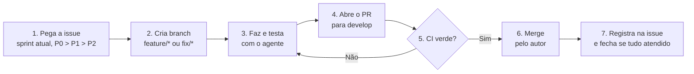

# Fluxo de trabalho do TCC

Fluxo para o dev trabalhar sozinho, com apoio de um agente de IA (Claude Code, Codex). Ninguém precisa atribuir, aprovar ou liberar nada. O que protege o projeto são regras claras e o CI, e o agente executa as partes repetitivas. Segue o [Git Flow](gitflow.md).



## Regras

1. **Qualquer dev pega qualquer issue aberta**, na ordem do [plano vigente](../planejamento/plano-pos-demo-issues-abertas.md): sprint atual (os prazos estão nos milestones do GitHub) e prioridade P0, P1, P2. Não precisa pedir. Depois do congelamento (11/11), só entra correção de bug P0. Se ficar com ela, atribui a si; se largar, remove a atribuição.
2. **CI verde é a única barreira para o merge.** Verde, o autor integra. Vermelho, corrige. Nunca desliga verificação nem usa `--no-verify`.
3. **O autor integra o próprio PR.** Não há revisão obrigatória antes nem depois.
4. **Todo critério de aceite vira teste ou comando.** O que não tem verificação não conta como atendido.
5. **Sem segredos.** Dados fictícios; nunca chaves, senhas ou dados reais do hospital.
6. **Issue só fecha com todos os critérios atendidos.** Entrega parcial: fica aberta, com a lista do que falta.

## Passo a passo

1. **Pegue a issue.** Leia o corpo e os critérios de aceite. Peça ao agente para resumir os critérios e propor como verificar cada um.
2. **Crie a branch** a partir da `develop` atualizada: `feature/nome` ou `fix/nome`.
3. **Desenvolva e teste com o agente.** O agente escreve o código e os testes, roda `pytest` e os scripts de aceite afetados, e repete no isolado qualquer teste de tempo que falhar (veja a [#45](https://github.com/Solution-Explores/SigmaTI/issues/45)).
4. **Abra o PR para `develop`.** O corpo traz: issue, critérios com a verificação de cada um, comandos e resultados.
5. **Confira o CI.** Vermelho: volte ao passo 3.
6. **Integre com o CI verde.** O autor faz o merge (pode usar auto-merge do GitHub).
7. **Registre na issue** o que mudou, o link do PR e as evidências. Se todos os critérios estão atendidos, feche a issue.

## O que o agente faz

Peça ao agente, em uma frase, e confira o resultado:

- ler a issue e listar critérios e verificações;
- criar a branch, escrever código e testes, e rodar a bateria;
- ler o próprio diff antes do push (segredos, dados reais, arquivos soltos);
- abrir o PR com o corpo preenchido e comentar a evidência na issue.

Bateria padrão (alguns scripts exigem PostgreSQL de teste em `SIGMA_TEST_DATABASE_URL`):

```bash
python -m pytest
python scripts/validate_api_acceptance.py
python scripts/validate_panel.py
python scripts/validate_collection.py
python scripts/validate_infrastructure.py
```

## Release e tag

Qualquer dev pode fazer, sem pedir liberação:

1. Com a `develop` verde, crie `release/X.Y.Z` e rode a bateria padrão.
2. Abra o PR para a `main`. Com o CI verde, integre.
3. Crie a tag `vX.Y.Z` no commit entregue e leve as correções de volta à `develop`.
4. Comente na issue da versão o SHA, a data e o resultado da bateria.

A `v1.0.0` é a meta da Sprint 1 do plano (milestone de 03/11). Hotfix: mesmo caminho, a partir da `main` (`hotfix/nome`).

[Voltar ao README](../../README.md)
