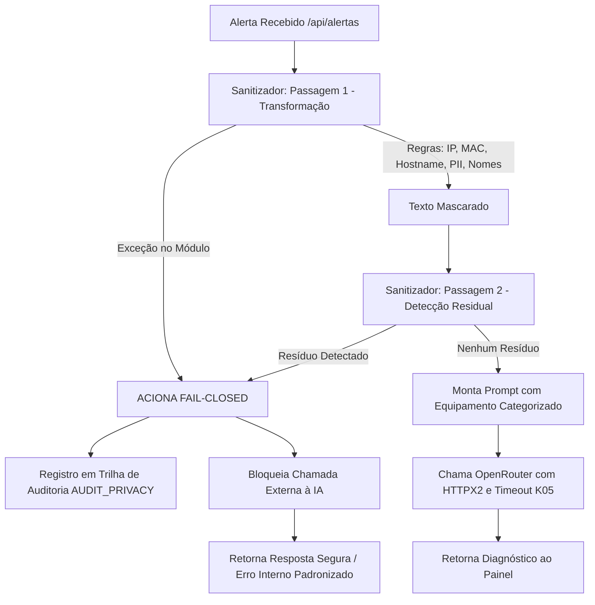

# Implementation Plan: Anonimização LGPD Robusta e Fail-Closed (RF05) #5

**Branch**: `005-anonimizador-fail-closed` | **Date**: 2026-10-18 | **Spec**: [spec.md](spec.md)  
**Input**: Requisitos de privacidade LGPD RF05, RNF08, mitigação dos bloqueadores B6 e B7 da Issue #5.

---

## Summary

Substituição da anonimização ingênua por um módulo desacoplado (`sanitizer.py`) capaz de generalizar endereços de rede (IPv4 -> /24, IPv6 -> /64), endereços MAC, classificar hostnames em categorias funcionais e neutralizar PII clínica e civil (CPF, CNS, prontuário, e-mail, nomes). Arquitetura *two-pass* com detecção residual estrita e garantia **Fail-Closed** (zero chamadas externas na presença de exceção ou resíduo). Validação empírica via Experimento E6 com 100% de Recall no corpus sintético.

---

## Technical Context

**Language/Version**: Python 3.12 (compatível com 3.14)  
**Primary Dependencies**: FastAPI, Pydantic, regex (`re`), standard library `ipaddress`, HTTPX2 (K05)  
**Storage**: Nenhuma tabela de/para (Art. 12 LGPD / RF05); auditoria em log seguro estruturado  
**Testing**: `pytest` com 33 testes específicos para sanitizer e fail-closed + regressão completa (K01 a K06)  
**Target Platform**: Linux / Docker Compose (stack SigmaTI)  
**Performance Goals**: Tempo de execução da sanitização < 5 ms por mensagem  
**Constraints**: Zero vazamento de dados brutos na presença de exceção ou resíduo de PII

---

## Arquitetura da Solução



---

## Estrutura de Arquivos Criados e Alterados

```text
SigmaTI/
├── sanitizer.py                         # Módulo de anonimização e detecção residual
├── main.py                              # Rota /api/alertas integrada com sanitizer e fail-closed
├── tests/
│   ├── test_sanitizer.py                # Testes unitários de cada classe de identificador
│   ├── test_fail_closed.py              # Testes de falha injetada, exceção e residual
│   └── data/
│       └── corpus_sintetico_pii.json    # Corpus anotado de testes com 50 casos
├── scripts/
│   └── executar_experimento_e6.py       # Script de cálculo de métricas e relatório
├── resultados/
│   └── experimento-e6-anonimizacao.md   # Relatório com números do Experimento E6
└── docs/specs/005-anonimizador-fail-closed/
    ├── spec.md                          # Especificação de requisitos e cenários
    ├── plan.md                          # Este plano de implementação técnica
    ├── tasks.md                         # Lista de tarefas concluídas
    ├── registro-issue.md                # Registro formal da Issue #5
    └── evidencias.md                    # Evidências de execução dos testes e CI
```
