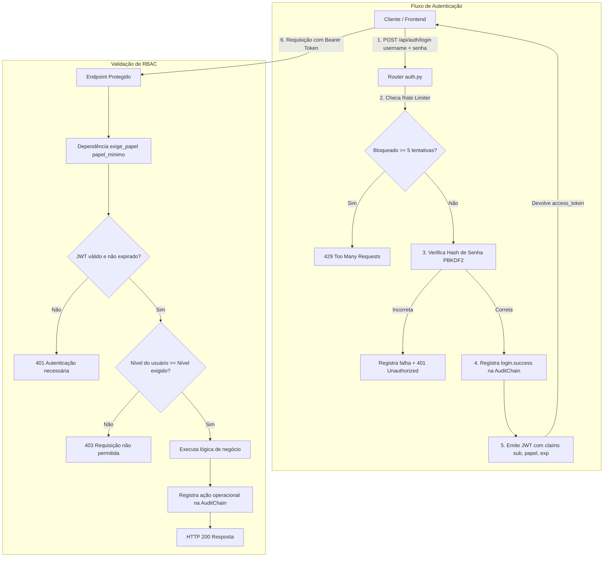

# Implementation Plan: Autenticação e Perfis (RF07): Login com JWT de Sessão e RBAC #6

**Branch**: `006-autenticacao-jwt-rbac` | **Date**: 2026-10-18 | **Spec**: [spec.md](spec.md)  
**Input**: Requisitos de autenticação e RBAC RF07, herança do Sentinel Vigilark, mitigação do Bloqueador B9.

---

## Summary

Implementação de uma camada de autenticação e autorização robusta baseada em JWT de sessão (HS256) com tempo de expiração curto (1 hora) e controle de acesso hierárquico por papéis (RBAC). A arquitetura estabelece hashing criptográfico de senhas via PBKDF2-HMAC-SHA256 com salt individual de 16 bytes, dependência FastAPI `exige_papel(...)` para validação declarativa de permissões conforme a matriz do `README.md`, limitação de taxa contra força bruta (lockout após 5 falhas consecutivas) e rastreabilidade com hashes encadeados na `AuditChain`.

---

## Technical Context

**Language/Version**: Python 3.12 (compatível com 3.14)  
**Primary Dependencies**: FastAPI, Pydantic, Standard Library Criptográfica (`hmac`, `hashlib`, `base64`, `secrets`, `time`)  
**Storage**: Repositório de usuários em PostgreSQL / in-memory compatível; trilha de auditoria append-only com `AuditChain` (JSONL)  
**Testing**: `pytest` com 67 testes novos cobrindo 100% da matriz de permissões, além de 280 testes de regressão no projeto  
**Target Platform**: Docker Compose / Linux (Stack SigmaTI)  
**Security Constraints**:  
- Tokens de sessão expiram;  
- Segredos permanentes do servidor (`OPENROUTER_API_KEY`) nunca são expostos;  
- Respostas de erro aderem à política pública K06 (401/403 genéricos sem vazamento de stacktrace ou metadados internos).

---

## Arquitetura da Solução



---

## Estrutura de Arquivos

```text
SigmaTI/
├── auth.py                               # Hashing PBKDF2, JWT HS256, RBAC e repositório de usuários
├── routers/
│   ├── __init__.py
│   └── auth.py                           # Rotas /api/auth/login, /logout e /me
├── main.py                               # Inclusão de roteadores e aplicação de exige_papel na matriz
├── engenharia/
│   ├── sigma_eng/
│   │   ├── api.py                        # Rotas /api/eng/* protegidas com exige_papel
│   │   └── audit_chain.py                # Ajuste de verdade booleana (__bool__) na AuditChain
│   └── docs/
│       └── 05-seguranca-e-pendencias.md  # Bloqueador B9 marcado como resolvido
├── tests/
│   ├── conftest.py                       # Fixture de isolamento de variáveis de ambiente
│   ├── test_session_auth.py              # 67 testes da suíte de autenticação e matriz RBAC
│   └── test_config.py                    # Ajuste de robustez de parsing de subprocessos no Python 3.14
└── specs/
    └── 006-autenticacao-jwt-rbac/
        ├── spec.md                       # Especificação do requisito e cenários de aceite
        ├── plan.md                       # Plano técnico de arquitetura
        ├── tasks.md                      # Checklist de tarefas executadas
        ├── registro-issue.md             # Documento de encerramento da Issue #6
        └── evidencias.md                 # Evidências completas de testes e auditoria
```

---

## Verificação e Critérios de Aceite

| Requisito | Critério | Validação |
|---|---|---|
| **Ausência de Token** | HTTP 401 retornado para qualquer endpoint da matriz sem credencial | `test_requisicao_sem_token_retorna_401` (15 testes) |
| **Papel Insuficiente** | HTTP 403 retornado quando o perfil tiver nível inferior ao exigido | `test_matriz_perfil_suporte_n1` e `test_matriz_perfil_analista_redes` |
| **Papel Autorizado** | HTTP 200 retornado quando o perfil tiver nível igual ou superior | `test_matriz_perfil_gestor_ti` (acesso irrestrito) |
| **Expiração de Sessão** | Tokens com `exp` ultrapassado são rejeitados com HTTP 401 | `test_token_expirado_rejeitado_com_401` |
| **Proteção de Segredos** | Chave permanente do servidor nunca aparece em respostas | `test_login_sucesso_retorna_jwt_e_nao_expoe_chave_permanente` |
| **Rate Limiting** | Bloqueio com HTTP 429 após 5 falhas consecutivas de login | `test_bloqueio_apos_5_tentativas_e_registro_na_auditchain` |
| **Integridade da Trilha** | Todos os eventos de login/logout/bloqueio gravados na AuditChain íntegra | `AuditChain.verificar()` retorna `(True, None)` |
