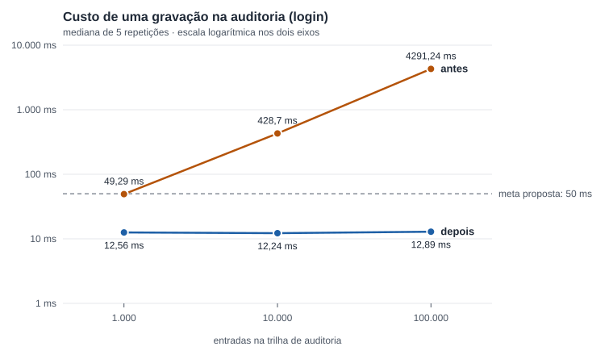

# Evidência para o TCC: custo da trilha de auditoria (#46)

Medição do custo de gravar na trilha de auditoria do SigmaTI conforme ela cresce, antes e depois da correção da issue #46 (PR #65). Os números abaixo são medidos; o que é interpretação ou limite está dito como tal.

[Voltar ao índice do TCC](../README.md)

## 1. Problema

A trilha de auditoria é uma cadeia de hash: cada entrada carrega o hash da anterior e é assinada com HMAC-SHA256 (ADR 0002). Antes da correção, **toda gravação, login e verificação relia o arquivo inteiro e refazia o HMAC de todas as entradas**, para ter certeza de que a trilha estava íntegra antes de acrescentar uma linha. O custo, portanto, dependia do tamanho do histórico, não do trabalho feito.

## 2. Resultado



**Figura 1.** Tempo de uma gravação feita no login, por tamanho da trilha (mediana de 5 repetições, escala logarítmica nos dois eixos). A linha tracejada é a meta proposta na issue (50 ms).

**Tabela 1.** Mediana, em milissegundos, de 5 repetições. Dados completos (inclusive p95, mínimo e máximo) em [`dados/`](dados/).

| Entradas | Tamanho do arquivo | Login antes | Login depois | Gravação antes | Gravação depois | Verificação completa antes | Verificação completa depois |
|---:|---:|---:|---:|---:|---:|---:|---:|
| 1.000 | 0,3 MB | 49,3 | 12,6 | 54,1 | 12,0 | 41,1 | 38,1 |
| 10.000 | 3,0 MB | 428,7 | 12,2 | 413,5 | 12,1 | 427,1 | 360,3 |
| 100.000 | 30,3 MB | 4.291,2 | 12,9 | 4.516,7 | 13,0 | 4.238,8 | 3.809,2 |

"Gravação" é uma gravação feita com a trilha parada havia mais de 3 s. "Login" é o mesmo trabalho com uma nova instância da trilha a cada chamada, como a API faz. A verificação completa é a checagem explícita (rota da API e job diário) e **continua percorrendo toda a trilha, de propósito**.

**O que os números mostram**

- **Antes**, o custo cresce na proporção do histórico: 100 vezes mais entradas (1 mil para 100 mil) levaram o login de 49 ms para 4,3 s (87 vezes). A gravação de uma única linha custava 4,5 s com 100 mil entradas.
- **Depois**, o custo de gravar deixou de depender do histórico: 12 a 13 ms nos três tamanhos. Com 100 mil entradas o login ficou cerca de 330 vezes mais rápido (4.291 ms para 12,9 ms) e abaixo da meta proposta de 50 ms.
- O piso de cerca de 12 ms vem da gravação em disco com `fsync` (ADR 0002), não da verificação.
- A verificação completa quase não mudou (3,8 s com 100 mil entradas), como esperado.

**Casos piores, que também são resultado**

| Situação (100 mil entradas) | Antes | Depois |
|---|---:|---:|
| Gravações em rajada, sem intervalo | 4.186 ms | 125,8 ms |
| Primeira gravação de um processo novo (depois de reiniciar a API) | 4.665 ms | 3.955 ms |

Em rajada, a escrita anterior é recente demais para o programa confiar na data do arquivo e ele reconfere os bytes (cerca de 100 ms por 30 MB). A primeira gravação depois de reiniciar continua exigindo uma verificação completa; o job de verificação ao iniciar (#13) a executa e aquece o estado.

## 3. Como foi resolvido

O programa passou a guardar em memória, por arquivo, o que já verificou: contagem de entradas, último hash e o SHA-256 dos bytes verificados. Em cada gravação ele lê e confere só o trecho acrescentado desde a última vez. Se qualquer byte do trecho já verificado mudar (edição, remoção, reordenação, troca do arquivo), o SHA-256 não bate, o estado é descartado, a verificação completa roda e **a gravação é recusada**, como antes. Detalhes no [ADR 0002](../../../engenharia/docs/adr/0002-cadeia-de-hash-na-auditoria.md).

## 4. Limites que precisam constar no texto

- **Brecha estreita aceita:** quem editar o arquivo mantendo o tamanho **e** restaurando a data de modificação, depois de 100 ms da última escrita, só é detectado pela gravação em até 30 s. A verificação completa (API e job diário) detecta na hora, e a chave HMAC continua impedindo forjar uma cadeia válida. Há teste que documenta esse limite.
- **Medido em um computador só**: PC doméstico (Windows, SSD, Python 3.12.14), 5 repetições por ponto. Cinco amostras não sustentam estimativa de p95 nem de comportamento com cache de arquivo frio. O Docker Desktop estava aberto durante as medições.
- **Não medido:** 1 milhão de entradas, disputa entre processos, VM Linux.
- **Meta:** os 50 ms eram uma proposta da issue, não um limite acordado com o orientador.
- **Código medido:** "antes" é o código do PR #60 (`c5cdfe6`, com a #13); "depois" é o do PR #65. Os dados são sintéticos (trilha montada por script, com o mesmo formato e chave HMAC de teste), sem dados reais.

## 5. Como reproduzir

```bash
python scripts/benchmark_auditoria.py --tamanhos 1000 10000 100000 --repeticoes 5 --saida resultado.json
python docs/tcc/evidencias/gerar_figura_auditoria.py   # redesenha a figura a partir de dados/
```

Para o "antes", rode o mesmo comando com `PYTHONPATH` apontando para o `engenharia/` do código do PR #60. O script monta a trilha direto no disco, confere com `verificar()` antes de medir e só usa uma pasta temporária.

## 6. Arquivos

| Arquivo | Conteúdo |
|---|---|
| [`auditoria-custo-46.svg`](auditoria-custo-46.svg) | Figura 1 (vetorial; converta para PNG ao inserir no editor de texto, se preciso) |
| [`dados/auditoria-custo-antes.json`](dados/auditoria-custo-antes.json) | Medição antes da correção |
| [`dados/auditoria-custo-depois.json`](dados/auditoria-custo-depois.json) | Medição depois da correção |
| [`gerar_figura_auditoria.py`](gerar_figura_auditoria.py) | Gera a figura a partir dos dados |
| `scripts/benchmark_auditoria.py` | Benchmark reproduzível |
